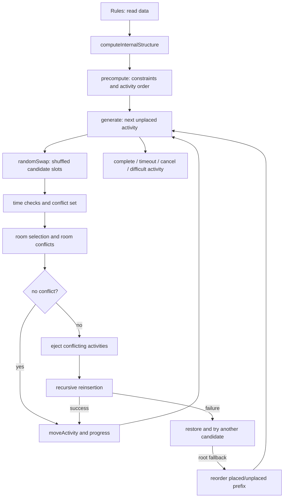

# 02 — Thuật toán scheduling thực tế

Phạm vi: FET 7.12.0 và hash tại [01](01-source-overview.md). Các đoạn thuật toán dưới đây là diễn giải, không phải code để chép vào sản phẩm.

## Entry point và call chain

**VERIFIED:** CLI `main` [`fetcl.cpp:1186`](../../../research/fet/fet-7.12.0/src/cl/fetcl.cpp#L1186) đọc file, gọi `Rules::computeInternalStructure` [`rules.cpp:6418`](../../../research/fet/fet-7.12.0/src/engine/rules.cpp#L6418), `Generate::precompute` [`generate.cpp:4335`](../../../research/fet/fet-7.12.0/src/engine/generate.cpp#L4335) rồi `Generate::generate` [`fetcl.cpp:4795`](../../../research/fet/fet-7.12.0/src/cl/fetcl.cpp#L4795). `precompute` chuyển thẳng tới `processTimeSpaceConstraints` [`generate_pre.cpp:1632`](../../../research/fet/fet-7.12.0/src/engine/generate_pre.cpp#L1632). GUI có tuyến chuẩn bị tương tự trong `TimetableGenerateForm::start` [`timetablegenerateform.cpp:177`](../../../research/fet/fet-7.12.0/src/interface/timetablegenerateform.cpp#L177), rồi thread gọi `generateWithSemaphore` [`timetablegenerateform.cpp:112`](../../../research/fet/fet-7.12.0/src/interface/timetablegenerateform.cpp#L112).

Graph thể hiện các bước, không coi mọi mũi tên là một direct call C++.

## Mô hình dữ liệu

**VERIFIED:** `Activity` là đơn vị xếp, không đồng nghĩa “một môn học”. Nó có duration, các teacher, subject/tags, student sets và `activityGroupId` để liên kết các phần của một split activity; xem [`activity.h:79`](../../../research/fet/fet-7.12.0/src/engine/activity.h#L79), [`activity.h:109`](../../../research/fet/fet-7.12.0/src/engine/activity.h#L109), [`activity.h:130`](../../../research/fet/fet-7.12.0/src/engine/activity.h#L130). Từ danh sách tên, preprocessing/internal structure tạo `iTeachersList`, `iSubgroupsList` [`activity.h:174`](../../../research/fet/fet-7.12.0/src/engine/activity.h#L174), [`activity.h:198`](../../../research/fet/fet-7.12.0/src/engine/activity.h#L198). Một activity có thể chiếm nhiều giáo viên và nhiều subgroup đồng thời.

**VERIFIED:** students hierarchy có year → group → subgroup tại [`studentsset.h:63`](../../../research/fet/fet-7.12.0/src/engine/studentsset.h#L63), [`studentsset.h:80`](../../../research/fet/fet-7.12.0/src/engine/studentsset.h#L80), [`studentsset.h:103`](../../../research/fet/fet-7.12.0/src/engine/studentsset.h#L103), [`studentsset.h:121`](../../../research/fet/fet-7.12.0/src/engine/studentsset.h#L121). Conflict phải xét overlap subgroup, không chỉ so chuỗi tên lớp. `Rules` giữ input lists và internal arrays [`rules.h:252`](../../../research/fet/fet-7.12.0/src/engine/rules.h#L252).

**VERIFIED:** `Solution` lưu `times[a]`, `rooms[a]` và real-room assignment cho phòng ảo [`solution.h:39`](../../../research/fet/fet-7.12.0/src/engine/solution.h#L39). Slot dùng **`time = day + hour * nDaysPerWeek`**; lấy ngày bằng modulo, giờ bằng chia nguyên. Không áp dụng nhầm convention `day*hours+hour`. Code giải mã tại [`generate.cpp:10285`](../../../research/fet/fet-7.12.0/src/engine/generate.cpp#L10285) và [`solution.cpp:255`](../../../research/fet/fet-7.12.0/src/engine/solution.cpp#L255). Duration chiếm các giờ liên tiếp cùng ngày.

**VERIFIED:** generator cache occupancy 3D theo teacher/subgroup/room; có old/new versions, số giờ/ngày, số gaps/ngày và danh sách activity của ngày [`generate.h:160`](../../../research/fet/fet-7.12.0/src/engine/generate.h#L160), [`generate.cpp:8918`](../../../research/fet/fet-7.12.0/src/engine/generate.cpp#L8918). Dữ liệu restore gồm activity/time/room/real rooms để rollback chính xác [`generate.h:119`](../../../research/fet/fet-7.12.0/src/engine/generate.h#L119), [`generate.cpp:40042`](../../../research/fet/fet-7.12.0/src/engine/generate.cpp#L40042).

## Preprocessing và chọn activity

**VERIFIED:** `processTimeSpaceConstraints` kiểm mode compatibility trước; Mornings-Afternoons yêu cầu số FET days chẵn, Terms yêu cầu days = terms × days-per-term [`generate_pre.cpp:1632`](../../../research/fet/fet-7.12.0/src/engine/generate_pre.cpp#L1632). Nhiều lỗi được phát hiện trước search; precompute không bảo đảm bài toán khả thi.

**VERIFIED:** các constraint được chuyển sang lookup: activity conflict maps, forbidden start percentages, availability masks, minimum-days adjacency lists, room domains, fixed flags. Ví dụ `computeNotAllowedTimesPercentages` [`generate_pre.cpp:16313`](../../../research/fet/fet-7.12.0/src/engine/generate_pre.cpp#L16313), `computeActivitiesConflictingPercentage` [`generate_pre.cpp:17317`](../../../research/fet/fet-7.12.0/src/engine/generate_pre.cpp#L17317), `computeActivitiesRoomsPreferences` [`generate_pre.cpp:22345`](../../../research/fet/fet-7.12.0/src/engine/generate_pre.cpp#L22345). Start khiến duration vượt ngày bị loại trước; availability của một slot loại mọi start có footprint chạm slot đó.

**VERIFIED:** `sortActivities` [`generate_pre.cpp:26500`](../../../research/fet/fet-7.12.0/src/engine/generate_pre.cpp#L26500) tính `nIncompatible` từ conflict với activity khác, start khó/cấm, giới hạn ngày của resource và mức khan hiếm phòng; nhân duration và nâng ưu tiên fixed activities. `compareFunctionGeneratePre` sắp giảm dần `nIncompatible`, rồi `nMinDaysConstraintsBroken` [`generate_pre.cpp:1612`](../../../research/fet/fet-7.12.0/src/engine/generate_pre.cpp#L1612). `stable_sort` dùng tại [`generate_pre.cpp:27133`](../../../research/fet/fet-7.12.0/src/engine/generate_pre.cpp#L27133). Có biến thể xét grouped activities/representative; không phải chỉ “xếp môn nhiều tiết trước”.

**VERIFIED:** `generate` sao chép initial permutation, dùng placed prefix và inverse permutation; khi ejection fallback, thứ tự này thay đổi. Activity tiếp theo là `permutation[added_act]`, không chạy chọn biến CP-SAT/MRV ở mỗi bước. Xem [`generate.cpp:8806`](../../../research/fet/fet-7.12.0/src/engine/generate.cpp#L8806), [`generate.cpp:9461`](../../../research/fet/fet-7.12.0/src/engine/generate.cpp#L9461), [`generate.cpp:9552`](../../../research/fet/fet-7.12.0/src/engine/generate.cpp#L9552).

## Chọn slot và room

**VERIFIED:** `randomSwap` [`generate.cpp:10229`](../../../research/fet/fet-7.12.0/src/engine/generate.cpp#L10229) tạo permutation toàn bộ start slots bằng shuffle tuyến tính dùng `rng.intMRG32k3a`. Với mỗi start, reset conflict list, xác định day/hour, kiểm forbidden start và constraint. Nếu bị chặn bởi activity fixed hoặc đã swapped, candidate trở thành không dùng được. Nếu không, activity xung đột được thêm một lần vào conflict list. Teacher/subgroup occupancy checks tại [`generate.cpp:10524`](../../../research/fet/fet-7.12.0/src/engine/generate.cpp#L10524).

**VERIFIED:** room được xét trong placement bằng `getRoom` [`generate.cpp:8581`](../../../research/fet/fet-7.12.0/src/engine/generate.cpp#L8581), `getPreferredRoom` [`generate.cpp:8535`](../../../research/fet/fet-7.12.0/src/engine/generate.cpp#L8535), `chooseRoom` [`generate.cpp:7100`](../../../research/fet/fet-7.12.0/src/engine/generate.cpp#L7100). Room availability được kiểm suốt duration; occupied room sinh conflict activity, trừ khi activity đó không thể di chuyển. Preferred-room constraints được kết hợp theo các nhánh apply/skip; không đơn giản lấy union tất cả các room đã khai báo. Hard preferred sets đang áp dụng được giao nhau; danh sách được sort trước shuffle để hạn chế nondeterminism do hash iteration.

**VERIFIED:** preprocessing loại room thiếu capacity khỏi miền phòng [`generate_pre.cpp:23124`](../../../research/fet/fet-7.12.0/src/engine/generate_pre.cpp#L23124). FET có `UNSPECIFIED_ROOM` và `UNALLOCATED_SPACE` khác nhau: “không yêu cầu chỉ định phòng” không đồng nghĩa “chưa xếp xong”. Virtual rooms có bài toán chọn real rooms; engine có maximum bipartite matching/Hopcroft–Karp [`generate.cpp:355`](../../../research/fet/fet-7.12.0/src/engine/generate.cpp#L355), [`generate.cpp:459`](../../../research/fet/fet-7.12.0/src/engine/generate.cpp#L459), và khởi tạo tại [`generate.cpp:8825`](../../../research/fet/fet-7.12.0/src/engine/generate.cpp#L8825). Matching là thành phần chọn phòng, không phải thuật toán giải toàn bộ TKB.

**VERIFIED:** candidate không conflict được commit ngay trong vòng duyệt đã shuffle [`generate.cpp:39810`](../../../research/fet/fet-7.12.0/src/engine/generate.cpp#L39810). Nếu cần repair, `compareFunctionGenerate` sort theo số conflict tăng dần [`generate.cpp:10200`](../../../research/fet/fet-7.12.0/src/engine/generate.cpp#L10200), [`generate.cpp:39840`](../../../research/fet/fet-7.12.0/src/engine/generate.cpp#L39840). Vì thế chọn slot chủ yếu theo conflict count, không đánh giá objective tổng của mọi lịch rồi lấy optimum.

## Recursive swapping, backtracking và fallback

**VERIFIED:** khái niệm được tác giả gọi recursive swapping trong `doc/algorithm/algorithm-description.txt`; implementation xác nhận ejection rồi recursive reinsertion. Không có bằng chứng tuyến generate hiện tại gọi OR-Tools/CP-SAT; build CLI link engine và QtCore, thuật toán được triển khai trực tiếp trong `Generate`.

**VERIFIED:** giới hạn trong build này: depth limit **14** và tối đa **2 × nInternalActivities** calls cho lần chèn; xem [`generate.cpp:9044`](../../../research/fet/fet-7.12.0/src/engine/generate.cpp#L9044), [`generate.cpp:10235`](../../../research/fet/fet-7.12.0/src/engine/generate.cpp#L10235). Đây là hằng số heuristic thực nghiệm, không phải giới hạn đủ để chứng minh feasibility/infeasibility.

**VERIFIED:** với candidate có conflicts: lưu trạng thái cũ, unallocate conflicts, đặt activity hiện tại, đánh dấu swapped, gọi `randomSwap(a, level+1)` cho từng activity bị đẩy. Nếu tất cả thành công thì commit; nếu không, restore theo thứ tự ngược. Từ depth ≥5, sau một variant repair thất bại sẽ trả về, không duyệt hết mọi lựa chọn sâu; [`generate.cpp:40030`](../../../research/fet/fet-7.12.0/src/engine/generate.cpp#L40030), [`generate.cpp:40080`](../../../research/fet/fet-7.12.0/src/engine/generate.cpp#L40080), [`generate.cpp:40105`](../../../research/fet/fet-7.12.0/src/engine/generate.cpp#L40105), [`generate.cpp:40124`](../../../research/fet/fet-7.12.0/src/engine/generate.cpp#L40124).

**VERIFIED:** khi root repair thất bại nhưng có candidate có thể đẩy activity, generator chọn root fallback dựa trên lịch sử removals, số conflict và thứ tự activity; đặt activity mới, đưa những activity bị đẩy trở lại unplaced portion, cập nhật `added_act`. Xem [`generate.cpp:39915`](../../../research/fet/fet-7.12.0/src/engine/generate.cpp#L39915), [`generate.cpp:9525`](../../../research/fet/fet-7.12.0/src/engine/generate.cpp#L9525). Đây là reorder/ejection heuristic, không phải complete search tree.

## Quality và lúc dừng

**VERIFIED:** `Solution::fitness` [`solution.cpp:137`](../../../research/fet/fet-7.12.0/src/engine/solution.cpp#L137) cộng penalty của internal time/space constraints và có conflict descriptions. Search vẫn ưu tiên đặt hết activities; normal generate không có vòng hậu tối ưu tổng fitness tương đương minimization toàn cục CP-SAT. `highestStageSolution` cập nhật khi số placed activities vượt kỷ lục, không khi soft score tốt hơn [`generate.cpp:9595`](../../../research/fet/fet-7.12.0/src/engine/generate.cpp#L9595).

**VERIFIED:** full allocation có thể còn broken soft constraints. Benchmark Pocht trả complete với soft total 9.93; [07](07-benchmark.md). **UNKNOWN:** optimum soft score, optimality gap và thời gian để đạt optimum; FET không cung cấp chứng minh optimum trong tuyến đã đọc.

Chi tiết timeout, cancel, randomness, khó xếp và hard/soft nằm ở [04](04-heuristics-and-conflicts.md); mapping constraint ở [03](03-constraint-catalog.md).
