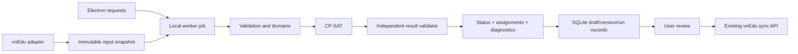

# 06 — Áp dụng cho vnEdu và đề xuất Scheduling Core

Trạng thái: **INFERRED — thiết kế đề xuất từ nghiên cứu**, chưa tạo module Python hoặc sửa ứng dụng. Kiến trúc Electron + React/TypeScript, Python + CP-SAT local, SQLite và API vnEdu là quyết định người dùng đã chốt, không mở lại lựa chọn framework.

## Những kỹ thuật đáng áp dụng

| Kỹ thuật | Bằng chứng FET — VERIFIED | Đề xuất vnEdu — INFERRED |
|---|---|---|
| Internal indices riêng với input IDs | [`rules.cpp:6418`](../../../research/fet/fet-7.12.0/src/engine/rules.cpp#L6418), [`activity.h:174`](../../../research/fet/fet-7.12.0/src/engine/activity.h#L174) | Giữ ID vnEdu gốc để đối chiếu, ánh xạ sang index solver trong một snapshot |
| Tách occurrence/block và phân công | [`activity.h:109`](../../../research/fet/fet-7.12.0/src/engine/activity.h#L109), [`activity.h:130`](../../../research/fet/fet-7.12.0/src/engine/activity.h#L130) | Phân công nhiều tiết/tuần sinh occurrences hoặc blocks theo quy tắc đã chốt |
| Flatten students sets | [`studentsset.h:63`](../../../research/fet/fet-7.12.0/src/engine/studentsset.h#L63), [`activity.h:198`](../../../research/fet/fet-7.12.0/src/engine/activity.h#L198) | Xét lớp/nhóm học giao nhau; không chỉ dùng tên lớp để chống trùng |
| Domain preprocessing | [`generate_pre.cpp:16313`](../../../research/fet/fet-7.12.0/src/engine/generate_pre.cpp#L16313), [`generate_pre.cpp:23124`](../../../research/fet/fet-7.12.0/src/engine/generate_pre.cpp#L23124) | Loại start/room vi phạm availability, duration, capacity và fixed lessons trước solve |
| Difficulty/conflict graph | [`generate_pre.cpp:26500`](../../../research/fet/fet-7.12.0/src/engine/generate_pre.cpp#L26500) | Dùng để chẩn đoán, hint hoặc chọn vùng sửa; không ràng buộc lịch phải theo đúng order này |
| Khóa time và room tách biệt | [`generate.cpp:7200`](../../../research/fet/fet-7.12.0/src/engine/generate.cpp#L7200), [`generate.cpp:10524`](../../../research/fet/fet-7.12.0/src/engine/generate.cpp#L10524) | Giáo vụ có thể khóa giờ nhưng cho solver chọn lại phòng, hoặc khóa cả hai |
| Current/highest checkpoint | [`generate.cpp:9595`](../../../research/fet/fet-7.12.0/src/engine/generate.cpp#L9595), [`fetcl.cpp:4951`](../../../research/fet/fet-7.12.0/src/cl/fetcl.cpp#L4951) | Lưu incumbent đã validate, trạng thái và score; không ghi đè lịch publish bằng bản tạm |
| Conflict report có ngữ cảnh | [`solution.cpp:137`](../../../research/fet/fet-7.12.0/src/engine/solution.cpp#L137), [`fetcl.cpp:4813`](../../../research/fet/fet-7.12.0/src/cl/fetcl.cpp#L4813) | Trả rule ID, activity/resource/slot liên quan và đơn vị vi phạm |
| Cancel hợp tác | [`fetcl.cpp:209`](../../../research/fet/fet-7.12.0/src/cl/fetcl.cpp#L209), [`generate.cpp:9464`](../../../research/fet/fet-7.12.0/src/engine/generate.cpp#L9464) | Worker process có request ID, cancel token và kết quả cuối; timeout/crash không thay lịch trước |

## Phạm vi dữ liệu chưa biết

**Cập nhật:** đã đọc [collection/contract](../vnedu-api-contract-review.md) và [kiểm chứng API đọc](../vnedu-api-live-findings.md): 38 lớp, 109 GV, 20 môn, 527 PCGD. **VERIFIED:** `so_tiet` toàn 0, 5 dòng thiếu tham chiếu GV. **UNKNOWN:** nhu cầu tiết thực, incumbent và policy trường. Chưa có adapter; bảng dưới vẫn là domain đề xuất, chưa coi schema SQLite hoặc mọi đầu vào là đã có từ API.

- Resource: giáo viên, lớp/nhóm, môn, phòng và cơ sở; ID ổn định.
- Horizon: tuần/ngày/buổi/period, thứ tự slot và khoảng nghỉ rõ ràng.
- Demand: phân công lớp–môn–giáo viên, số tiết và quy tắc split/block.
- Availability và yêu cầu mềm riêng; hard/soft không mã hóa bằng “100%/95% giống FET”.
- Fixed lesson và incumbent schedule, có mức khóa time/room.
- Rule: ID, loại, scope, tham số, severity, weight/priority, nguồn và version.

**INFERRED:** không copy cách đánh chỉ số `day+hour*days` của FET vào API. Dùng slot ID rõ nghĩa và adapter cục bộ nếu muốn so với FET. Với hai buổi, phân biệt real day với half-day; FET dùng `d/2` trong một số mode [`generate.cpp:10635`](../../../research/fet/fet-7.12.0/src/engine/generate.cpp#L10635).

## Mô hình CP-SAT đề xuất

Với mỗi occurrence hoặc duration-block `a`, preprocessing tạo tập placement `P[a]` hợp lệ: ngày/buổi/start/room và toàn bộ footprint. Đặt Boolean `x[a,k]` chọn placement `k`. Đây là encoding đầu tiên đề xuất để dễ kiểm tra; nếu số biến quá lớn mới đo để đổi sang interval/room assignment khác.

1. **Đủ demand:** mỗi occurrence chọn đúng một placement; tổng duration theo phân công khớp số tiết. Không silently bỏ activity để lấy nghiệm “đẹp”. Partial schedule nếu có phải là chế độ chẩn đoán riêng.
2. **Không trùng:** với mỗi teacher, atomic student group và physical room, tại mỗi slot tổng `x` có footprint chiếm resource đó ≤1. Co-teaching/shared students phải được biểu diễn thật trong resource set. “Không cần phòng” không phải một phòng chung chỉ chứa được một activity.
3. **Đúng miền:** duration không xuyên ngày/buổi/break theo đặc tả; phòng tương thích/capacity và availability nằm trong preprocessing. Room preferences không được loại domain như hard nếu chúng chỉ là soft.
4. **Fixed constraints:** ép placement hoặc các thành phần time/room tương ứng. Giữ ID khóa để báo conflict cụ thể.
5. **Load/spread:** occupancy sums theo ngày/buổi, ngày có dạy, giới hạn môn/ngày, spacing giữa occurrences và consecutive blocks theo rule được xác nhận.

**INFERRED:** khi dùng nhiều placements tương đương, có thể thêm symmetry breaking cho các occurrences thật sự không phân biệt. Không ép thứ tự giữa những tiết có yêu cầu, khóa hoặc phòng khác nhau. Room equivalence chỉ có khi availability/capacity/preferences thật sự giống nhau.

## Soft objective và validator

**INFERRED:** đặc tả từng penalty bằng một đơn vị rõ: ngày vượt tải, số giờ vượt tải, số gap, số cặp môn đặt quá gần, số lesson lệch incumbent. Không dùng chung một “điểm vi phạm” khi ý nghĩa khác nhau. FET cho thấy khác biệt này ở [`timeconstraint.cpp:13695`](../../../research/fet/fet-7.12.0/src/engine/timeconstraint.cpp#L13695) và [`timeconstraint.cpp:21020`](../../../research/fet/fet-7.12.0/src/engine/timeconstraint.cpp#L21020).

Ưu tiên giải hard-feasible trước, rồi minimize các nhóm soft theo priority đã chốt. Có thể giải nhiều tầng; chỉ tuyên bố tầng trước tối ưu khi có `OPTIMAL`, hoặc ghi rõ incumbent hạn chế nếu mới `FEASIBLE`. Không đặt hệ số khổng lồ nếu chưa tính bound tránh tràn/sai ưu tiên.

Gaps phải định nghĩa trên teaching slots: có tính unavailable, họp, break, trước tiết đầu/sau tiết cuối, giữa hai buổi hay không. Không port `GetValue_*` STKB hoặc `weightPercentage` FET thành penalty khi chưa có đặc tả vnEdu.

Validator độc lập nhận snapshot + assignments, tự tính footprint/occupancy, demand, khóa và penalty breakdown. Nó không đọc các biến helper nội bộ model để tự xác nhận model. Nghiệm chỉ được lưu thành incumbent hợp lệ sau validator; solver status không thay thế validator nghiệp vụ.

## Ranh giới runtime đề xuất

**INFERRED:** job ghi input hash, schema/rule/model/OR-Tools versions, seed, budget, workers và job ID. Kết quả có completion, solver status, objective/bound, elapsed và violation details; không coi exit code process là status bài toán. Lưu bản nháp/phiên bản theo transaction; sync API là bước riêng sau review, không gọi trong worker solve. Không triển khai schema SQL hoặc IPC trong nhiệm vụ nghiên cứu này.

Stop phải xử lý cả lúc chưa có nghiệm: trả cancelled/time-limit kèm incumbent nếu có, giữ nguyên bản publish. Callback có thể cập nhật tiến độ/giữ incumbent; không hứa có callback thường xuyên khi chưa tìm được nghiệm mới. Có cơ chế cancel ngoài callback và watchdog process với thời gian cleanup khi triển khai.

## Xếp lại một phần

**INFERRED:** bắt đầu với full CP-SAT model nhưng khóa các activity ngoài vùng sửa; hint incumbent cho phần còn lại. Hard khóa bất biến của người dùng có ưu tiên hơn mục tiêu giảm thay đổi. Tối ưu số activity đổi trước, rồi soft quality nếu đó là ưu tiên giáo vụ.

Nếu vùng sửa infeasible, không suy ra toàn bài infeasible: báo khóa/ràng buộc liên quan hoặc mở neighborhood theo teacher/student/room conflict graph. Candidate vùng phải tính cả boundary constraints (daily load, spacing, travel), không chỉ clash trong vùng. Repair chỉ commit sau validate toàn lịch. Chỉ thêm orchestration này khi benchmark chứng minh nhu cầu; không viết lại FET recursive swapping trong Python ngay từ đầu.

## Lộ trình triển khai sau nghiên cứu

| Mốc đề xuất | Sản phẩm cần có | Kiểm chứng |
|---|---|---|
| 1 — domain/rules | Contract ánh xạ API, fixture synthetic, hard/soft units | Thiếu ID, demand, availability mâu thuẫn bị từ chối có ngữ cảnh |
| 2 — feasibility | Domain preprocessing, basic CP-SAT và validator | Ví dụ nhỏ có nghiệm/vô nghiệm, block qua nghỉ, lớp ghép, teacher/room clashes |
| 3 — quality | Các soft priority đã đặc tả | So với vét cạn bài nhỏ; evaluator khớp, incumbent không vi phạm hard |
| 4 — runtime | Worker progress/cancel/budget và versioned result | Timeout chưa có nghiệm, cancel khi đang solve, stale result và crash không mất lịch trước |
| 5 — repair | Giữ phần lịch khóa, minimize changes | So toàn lịch, kiểm boundary, chỉ mở vùng theo chính sách rõ |
| 6 — benchmark tương đương | FET vs CP-SAT trên cùng hard/soft interpretation | Nhiều seed, same locks/domains/target score; không dùng số liệu locked benchmark để quảng cáo |

**UNKNOWN trước triển khai:** contract vnEdu cụ thể, quy mô trường mục tiêu, ưu tiên hard/soft, lớp ghép/đồng giảng, phòng chuyên môn và ngân sách solve. Đây là các dữ kiện để chốt đặc tả sau nghiên cứu, không phải lý do để tự cài OR-Tools hoặc xây UI lúc này.
