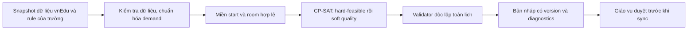

# Đối chiếu STKB 5.0 và FET cho nghiệp vụ xếp TKB vnEdu

Ngày: 2026-10-25. Đây là bản tổng hợp hai nghiên cứu đã có, **chưa phải đặc tả nghiệp vụ được trường xác nhận và chưa triển khai solver**.

Thiết kế kế tiếp: [Scheduling Core kết hợp STKB/FET/CP-SAT](../superpowers/specs/2026-10-25-scheduling-core-design.md), giữ phân biệt bằng chứng và lựa chọn thiết kế; chưa triển khai engine.

## 1. Kết luận đề xuất

**INFERRED:** giữ Python + OR-Tools CP-SAT làm Scheduling Core theo kiến trúc đã chốt. Dùng STKB để nhận diện nhóm yêu cầu quen thuộc của giáo vụ: phân công, tiết đôi, giới hạn tải, tiết trống, nghỉ và tinh chỉnh lịch. Dùng FET để làm rõ cấu trúc activity, nhóm học giao nhau, duration, availability, phòng, khóa và các trường hợp biên. Học kỹ thuật từ cả hai nhưng viết đặc tả/mô hình độc lập.

Ưu tiên một bản đầu xếp **đủ tiết, đúng phân công, không trùng, đúng lịch được phép và giữ khóa**. Sau đó bổ sung tiêu chí chất lượng có đơn vị rõ ràng. Repair tối thiểu thay đổi nên là khả năng của giai đoạn tiếp theo; chưa có căn cứ để viết lại FPR/DPR hoặc recursive swapping bằng Python.

**Cập nhật đầu vào API:** đã đọc collection 21 request và [kiểm chứng API đọc trực tiếp](vnedu-api-live-findings.md): 38 lớp, 109 GV, 20 môn, 527 PCGD, 2 điểm trường. Có field `so_tiet` nhưng cả 527 giá trị bằng 0; 5 dòng thiếu tham chiếu GV. **UNKNOWN:** nhu cầu tiết thực, nguyên nhân thiếu GV, định dạng TKB và chính sách trường. Xem thêm [contract từ collection](vnedu-api-contract-review.md). “Phù hợp vnEdu” vẫn là đề xuất thiết kế, không khẳng định API bắt buộc hoặc cung cấp đủ mọi ràng buộc.

## 2. Độ tin cậy của hai nguồn

| Nguồn | VERIFIED | Giới hạn |
|---|---|---|
| STKB 5.0 | PE native C++/MFC; 49 dossier Hopper; pipeline xếp nhiều pha, FPR/DPR repair, ba view lịch và một nhánh chấp nhận điểm mới thấp hơn | Chưa đủ mapping mã ràng buộc, trọng số, layout và semantics mọi nhánh; tên hàm chưa đủ để chứng minh quy tắc cụ thể |
| FET 7.12.0 | Source khớp archive chính thức; 357 concrete constraint classes; 29 nhóm đọc sâu; recursive swapping; 14 benchmark runs | Chưa audit semantics riêng toàn bộ catalog; nhiều giới hạn mode/tổ hợp; timeout không phải chứng minh vô nghiệm |
| vnEdu | Người dùng đã chốt kiến trúc và cho biết có API lấy/đồng bộ dữ liệu | Đã kiểm chứng một snapshot API đọc; còn thiếu nhu cầu tiết hợp lệ và chính sách trường |

**VERIFIED** chỉ áp dụng hành vi đã đọc/quan sát. Các quyết định hard/soft, thứ tự triển khai và mô hình CP-SAT bên dưới là **INFERRED — đề xuất**. Dữ kiện chưa có được ghi **UNKNOWN**. Không suy luận rằng hai chương trình có cùng thuật toán hoặc cùng định nghĩa điểm.

Nguồn tổng: [STKB — phân tích binary](../../reverse-engineering/reports/STKB-algorithm-analysis.md), [FET — source overview](fet/01-source-overview.md), [FET — catalog](fet/03-constraint-catalog.md).

## 3. Ma trận ràng buộc nên đưa vào Scheduling Core

P0 = phải có trước khi dùng lịch tự động; P1 = chất lượng và chính sách trường thường gặp; P2 = triển khai khi dữ liệu/nghiệp vụ chứng minh cần. P0 có điều kiện chỉ bắt buộc khi chức năng tương ứng được sử dụng; ví dụ dữ liệu không có phòng thì không tự tạo phòng giả.

### 3.1. Quy tắc hợp lệ nền tảng

Tất cả lựa chọn ở cột “Đề xuất” là **INFERRED**. Cột nguồn dẫn đến bằng chứng cụ thể ở phần 8; không tự biến suy luận STKB thành VERIFIED.

| ID | Nhu cầu nghiệp vụ | Đối chiếu hai nguồn | Đề xuất | Hướng mô hình và kiểm tra |
|---|---|---|---|---|
| C01 | Đủ số tiết theo phân công lớp–môn–giáo viên | STKB còn bộ đếm phân công, kiểm tra hoàn thành [S1](#s1); FET activity/duration/split [F1](#f1) | **P0, hard**. Giáo viên do phân công đầu vào quyết định; không tự đổi để xếp dễ hơn | Chuẩn hóa phân công thành occurrences/blocks; mỗi occurrence đúng một placement; tổng duration khớp demand theo phân công |
| C02 | Một giáo viên không dạy hai hoạt động chồng thời gian | STKB view GV và repair [S2](#s2); FET occupancy mọi giờ của duration [F2](#f2) | **P0, hard**, dùng teacher ID dùng chung xuyên lớp/buổi/cơ sở | Tổng footprint của một teacher tại mỗi thời điểm ≤1; không chỉ so chuỗi “tiết 1” |
| C03 | Một lớp/nhóm học không tham gia hai hoạt động chồng nhau | STKB view lớp [S2](#s2); FET atomic subgroups [F1](#f1), [F2](#f2) | **P0, hard** với lớp thường; nhóm giao nhau chỉ mở rộng khi trường có | Một resource cho lớp thường. Khi có nhóm giao nhau, kiểm tra các nhóm học sinh thành phần, không chỉ tên lớp |
| C04 | Phòng thật không bị chiếm đồng thời | STKB view phòng và FPR [S2](#s2); FET room occupancy [F3](#f3) | **P0 nếu xếp phòng, hard** | Giới hạn occupancy của room thật trên toàn duration; “không yêu cầu phòng” không phải một phòng dùng chung bị giới hạn 1 |
| C05 | Chỉ xếp trong lịch hoạt động hợp lệ | STKB có miền ngày/buổi/tiết trong các hàm đã đọc [S3](#s3); FET forbidden starts theo duration [F4](#f4) | **P0, hard** | Calendar xác định ngày/buổi/period và break. Không hardcode miền 7 ngày × 5 tiết của binary STKB |
| C06 | Giáo viên/lớp/phòng không được xếp ở thời gian thật sự không khả dụng | STKB có checks và penalty bận, chưa khôi phục toàn bộ phân loại [S3](#s3), [S5](#s5); FET availability/breaks [F4](#f4) | **P0, hard cho lệnh cấm**. “Muốn tránh” là preference riêng | Loại mọi start có footprint giao vùng cấm; cuộc họp chỉ chặn các giáo viên tham gia |
| C07 | Giữ các tiết giáo vụ đã khóa | STKB có cờ bảo vệ, semantics đầy đủ còn thiếu [S4](#s4); FET phân biệt fixed-time/fixed-space [F2](#f2), [F3](#f3) | **P0, hard khi có khóa**; tách khóa giờ và khóa phòng | Ép time và/hoặc room theo mức khóa; phát hiện khóa mâu thuẫn trước solve |
| C08 | Một block có duration xác định phải được xếp trọn vẹn | STKB có nhánh xếp một/hai cặp, chưa đủ mọi chế độ [S6](#s6); FET duration và consecutive khác nhau [F1](#f1), [F5](#f5) | **P0 nếu có block, hard** | Một start chiếm đủ duration; không cắt block hoặc đi qua break/buổi/ngày nếu đặc tả không cho phép |
| C09 | Phòng phù hợp môn học và quy mô lớp | STKB `CanTeachInRoom`/quan hệ phòng–môn còn thiếu schema [S7](#s7); FET capacity/preferred rooms [F3](#f3) | **P0 khi có yêu cầu phòng bắt buộc**; phòng ưa thích là soft | Chỉ loại room không đáp ứng yêu cầu vật lý đã khai báo. Thiếu capacity/equipment là thiếu dữ liệu, không mặc định là đạt |

### 3.2. Chính sách trường và tiêu chí chất lượng

Các quy tắc này không nên tự bật thành hard chỉ vì STKB/FET có hỗ trợ. Nếu một giới hạn được trường quy định bắt buộc, nó trở thành hard; nếu là mong muốn thì là soft. Không âm thầm nới hard khi khó xếp.

| ID | Nhu cầu nghiệp vụ | Đối chiếu nguồn | Đề xuất ưu tiên / hard–soft | Đơn vị hoặc điều kiện cần chốt |
|---|---|---|---|---|
| C10 | Giới hạn tiết dạy/học mỗi ngày, mỗi buổi | STKB `GetValue_MaxTietNgay`, `MaxTietBuoi` [S5](#s5); FET max-hours [F6](#f6) | **P1**; trần bắt buộc là hard, quá tải mong muốn là soft | Tổng **duration**, không phải số occurrence; tổng một ngày có xét cả hai buổi |
| C11 | Không dạy/học liên tục quá nhiều tiết | FET max-continuously [F6](#f6); không khẳng định đã map predicate STKB tương đương | **P1**, policy trường | Định nghĩa break/khoảng rỗng có cắt chuỗi liên tục không; đo run length |
| C12 | Tránh giáo viên đến trường chỉ dạy một tiết; tối thiểu tiết trong buổi có dạy | STKB các tên `ChiCoMotTiet`/nghỉ trong score, chưa đủ semantics [S5](#s5); FET min-hours [F6](#f6) | **P1**, đề xuất soft trước khi trường xác nhận hard | Điều kiện **có dạy** mới áp dụng min-load; không ép giáo viên phải dạy mọi ngày |
| C13 | Phân bố cùng môn ra các ngày, tránh dồn | STKB `CachMon`, `HocCachNgay/HaiNgay` [S5](#s5); FET min-days [F5](#f5) | **P1**, soft mặc định đề xuất; ngoại lệ hard theo môn | Khoảng cách theo ngày thật; phạt theo cặp, theo ngày hoặc mức thiếu khoảng cách phải được định nghĩa |
| C14 | Không quá số tiết của một môn trong cùng ngày/buổi | STKB có điểm kiểm giới hạn môn, trường giới hạn chưa giải nghĩa chắc [S3](#s3); FET activity-tag daily/selected-slot families [F8](#f8) | **P1**, giới hạn do trường chốt | Gom đúng lớp–môn và cộng duration. Dùng tag/grouped activities để ánh xạ khi so với FET, không gọi là cùng một rule sẵn có |
| C15 | Có đúng số cặp tiết đôi cho một môn | STKB `XepMotCapTiet`, `XepHaiCapTiet` và score cặp [S6](#s6); FET split/grouped/consecutive [F5](#f5) | **P1**; số cặp bắt buộc là hard, ưu tiên đôi là soft | Số block/tuần, duration và số tiết lẻ phải bảo toàn demand; không đếm trùng cặp trong chuỗi ba/bốn tiết |
| C16 | Giảm tiết trống bên trong lịch giáo viên | STKB `MaxEmpty`, `TotalEmpty` có body/weight đã đọc [S5](#s5); FET gaps [F7](#f7) | **P1, soft trước**; hard bound khi được xác nhận | Tách tổng số tiết trống với khoảng trống liên tiếp dài nhất; đầu/cuối buổi không mặc định là gap |
| C17 | Giữ buổi học của lớp gọn, hạn chế học sinh trống tiết | STKB có metric/score tên liên quan nhưng mapping chưa đầy đủ [S5](#s5); FET student gaps/early [F7](#f7) | **P1**; cấm gap có thể hard theo trường | Không nhập chung gap học sinh với gap giáo viên; break và thời gian không học phải có semantics riêng |
| C18 | Sắp xếp ngày/buổi nghỉ, gom số ngày giáo viên đến trường | STKB `SoBuoiNghi`, `SoNgayNghi`, `ChiDayNgay` mới xác nhận là thành phần score [S5](#s5); FET min/max days [F6](#f6) | **P1, soft** trừ ngày nghỉ đã cấm ở C06 | Đếm ngày thật và half-day riêng; “tối đa buổi đến trường” khác “muốn nghỉ một buổi cụ thể” |
| C19 | Ưu tiên môn/giáo viên ở đầu buổi, cuối buổi hoặc khung giờ | STKB các `ChiHocTiet1/5`, `KhongHocTiet...` [S5](#s5); FET preferred starts/slots [F4](#f4) | **P1, soft**; hard chỉ khi trường cấm rõ | Phân biệt ưu tiên **start** với yêu cầu toàn bộ footprint nằm trong khung; không mặc định mọi môn “nặng” phải học đầu buổi |
| C20 | Đủ thời gian di chuyển giữa phòng/cơ sở | STKB `Check_OneSiteHalfDay` trong checker giáo viên [S3](#s3); FET building/room changes [F3](#f3), [F8](#f8) | **P2**, hard khi có travel time thực tế; hạn chế đổi phòng có thể soft | Hai phòng khác nhau chưa chắc khác cơ sở; cần lịch giờ thật và thời gian di chuyển, không đoán từ số tiết |
| C21 | Chào cờ, sinh hoạt, họp tổ và hoạt động chung | STKB có symbol `StietChaoco`, `StietSinhhoat`, `StietHOP`, chưa audit mọi body [S3](#s3); FET activity/fixed/same-start [F1](#f1), [F5](#f5) | **P0 qua C05–C08** khi dữ liệu đã có; không cần engine sự kiện riêng | Xác định hoạt động có tính vào demand không, lớp/giáo viên nào tham gia, tài nguyên chung cần chiếm. Không vừa giữ slot vừa sinh lại lesson đó |
| C22 | Chỉnh một phần, ít xáo trộn lịch đã được giáo viên nhận | STKB thử thay/rollback và repair [S4](#s4); FET có khóa và reinsertion [F9](#f9); chưa chứng minh cả hai có objective minimal-change tương đương | **P1 cho chế độ sửa lịch**, sau feasibility bản đầu | Hard giữ khóa; soft giảm số occurrence đổi time, đổi ngày, đổi phòng với thứ tự ưu tiên rõ. Hint không phải khóa |

**UNKNOWN cần chốt với trường:** các ngưỡng cụ thể; môn nào phải đôi; định nghĩa gap; giới hạn giờ/ngày; chính sách hai buổi, giáo viên đa cơ sở, lớp ghép và phòng. Chưa có căn cứ để gán trọng số mặc định 1/10/100 hoặc đặt tất cả preference thành bắt buộc.

## 4. Những khác biệt không được nhập nhằng

| Vấn đề | Bằng chứng đối chiếu | Quyết định đề xuất cho vnEdu — INFERRED |
|---|---|---|
| Hard và soft | STKB có pre-check và score nhưng mapping chưa đầy đủ; FET có stochastic weight và các loại chỉ nhận 100% [S3](#s3), [S5](#s5), [F10](#f10) | Lưu severity và penalty units tường minh; không dùng FET percentage hoặc sentinel STKB làm contract nghiệp vụ |
| Đơn vị phạt tải | STKB MaxTietNgay cộng mức vượt × weight; FET TeacherMaxHoursDaily fitness đếm ngày vi phạm [S5](#s5), [F6](#f6) | Chốt phạt “mỗi tiết vượt” hay “mỗi ngày vượt”; hai objective có thể chọn hai lịch khác nhau |
| Cặp tiết và block | FET TwoActivitiesConsecutive có thể bỏ break; một activity duration>1 chiếm toàn footprint [F5](#f5) | Quy tắc block cho phòng thực hành khác quy tắc “hai môn sát nhau theo tiết học hiệu lực” |
| Một ngày và một buổi | STKB có lịch theo buổi; FET Mornings-Afternoons dùng half-day và `d/2` cho real-day [S2](#s2), [F5](#f5) | Giữ day, session và period riêng; tổng tải/nghỉ theo ngày phải cộng đúng hai buổi |
| Phòng không bắt buộc và phòng chưa xếp | FET phân biệt unspecified/unallocated; benchmark XML có thể để room trống trong cả hai tình huống [F11](#f11) | Có trạng thái room_required/room_assignment riêng; lịch thiếu phòng bắt buộc chưa được hoàn thành |
| Lịch tốt nhất | STKB nhánh tối ưu nhận score giảm; FET highest-stage chọn theo completion chứ không score [S4](#s4), [F9](#f9) | Chỉ so chất lượng giữa các lịch hard-valid, đủ demand; lưu completion và objective riêng |
| Đã xếp đủ và đã hợp lệ | STKB TestSuccessfulTKB chủ yếu liên quan bộ đếm; FET current có thể mang state trung gian [S1](#s1), [F11](#f11) | Validator độc lập kiểm demand, resource, khóa, duration, phòng và toàn bộ hard rules trước khi publish |

Không suy ra “FET tốt hơn STKB” hoặc “CP-SAT chắc chắn nhanh hơn”. STKB chưa có benchmark runtime tương đương; benchmark FET không có model CP-SAT cùng dữ liệu/semantics để so tốc độ.

## 5. Kỹ thuật nên dùng và phần nên để sau

| Kỹ thuật | Học từ đâu | Đề xuất áp dụng |
|---|---|---|
| Chuẩn hóa phân công và ID | FET internal indices; STKB trạng thái phân công/view [S1](#s1), [F1](#f1) | **Dùng ngay:** giữ vnEdu IDs gốc, sinh internal indices/occurrence IDs ổn định; map ngược kết quả theo snapshot |
| Thu hẹp miền placement trước solve | FET availability/duration/capacity [F3](#f3), [F4](#f4) | **Dùng ngay:** chỉ tạo start/room khả dụng; phát hiện miền rỗng, tải vượt khả năng, khóa mâu thuẫn. Đây là điều kiện cần, không đủ để kết luận khả thi |
| Mô hình resource thống nhất | STKB ba view lớp/GV/phòng; FET occupancy theo teacher/subgroup/room [S2](#s2), [F2](#f2) | **Dùng ngay:** assignment là dữ liệu gốc; các view là suy ra. Mỗi block chiếm mọi resource trên mọi slot của duration |
| Kiểm tra độc lập và báo conflict | STKB checker theo resource; FET fitness explanations [S3](#s3), [F10](#f10) | **Dùng ngay:** rule ID, lesson/resource/slot, actual/limit và severity; cùng rule catalog cho model và validator nhưng hai cách tính độc lập |
| Feasibility trước chất lượng | STKB nhiều pha; FET ưu tiên completion [S4](#s4), [F9](#f9) | **Dùng ngay:** tìm nghiệm hard-valid, sau đó optimize preference trong tổng budget; không biến thiếu tiết thành preference để dễ có nghiệm |
| Incumbent, cancel và ghi kết quả nhất quán | STKB rollback; FET current/highest/cancel [S4](#s4), [F11](#f11) | **Dùng ngay:** giữ best validated incumbent, trả trạng thái rõ, không thay lịch đã publish bằng partial/stale result |
| Lặp lại thử nghiệm bằng seed | FET seed và stable ordering [F9](#f9) | **Dùng ngay khi kiểm chứng:** input hash + model/rule/solver version + seed + workers/budget. Không hứa seed bảo đảm cùng lịch giữa các solver versions |
| Hard-first/difficulty ordering | FET sortActivities; STKB ưu tiên cặp rồi phân công [S6](#s6), [F9](#f9) | **Sau đo:** có thể tạo hint hoặc chọn vùng sửa; chưa ép search strategy tùy ý vào CP-SAT chỉ để giống FET |
| Repair theo vùng xung đột | STKB FPR/DPR; FET recursive swapping [S4](#s4), [F9](#f9) | **Sau feasibility/quality:** giữ phần ngoài vùng sửa bằng equality, giải lại vùng liên đới; mở rộng khi cần; kiểm boundary rules toàn lịch |
| Tự viết tabu/ejection tree/local search | Có trong engine FET và repair STKB, mức khôi phục khác nhau [S4](#s4), [F9](#f9) | **Chưa làm:** CP-SAT là core đã chọn. Chỉ bổ sung nếu benchmark cho thấy cần và có cùng validator/objective |

**INFERRED:** pipeline tối thiểu:

Chỉ mô tả ranh giới nghiệp vụ; không tạo UI, SQL, IPC hoặc gọi API đồng bộ trong nhiệm vụ này.

## 6. Mô hình và tiêu chí nghiệm đề xuất

**INFERRED:** với mỗi occurrence/block `a`, tạo tập placement hợp lệ `P[a]`; Boolean `x[a,k]` chọn placement `k`. Một placement gồm day/session/start, duration, room thật nếu cần và resource footprint. Đây là biểu diễn đề xuất, chưa phải quyết định encoding tối ưu về hiệu năng.

- Đúng một placement mỗi occurrence; tổng duration khớp phân công C01.
- Không overlap resource C02–C04 trên trục thời gian đã chuẩn hóa.
- Loại miền theo C05/C06/C08/C09; ép khóa C07. Không loại preference khỏi domain.
- Thêm các policy C10–C22 đã được trường chốt; không tự chọn hết 357 constraint FET.
- Đầu ra có status, input/rule version, completion count, missing requirements, objective breakdown và violations. Có time assignment nhưng thiếu room_required không được coi là complete.

Chất lượng lịch được so theo hai chế độ:

| Chế độ | Điều kiện bắt buộc | Ưu tiên mềm đề xuất cần giáo vụ chốt |
|---|---|---|
| Xếp mới | Đủ demand, không vi phạm hard, giữ các tiết đã khóa | Phân bố môn, lịch học sinh gọn, tải/gaps/nghỉ giáo viên và khung giờ ưa thích |
| Sửa lịch | Cùng hard model; giữ khóa bất biến; phần đóng băng được bảo toàn | Hạn chế số lesson đổi vị trí trước, rồi cải thiện chất lượng trong vùng được phép |

Nếu tối ưu theo nhiều tầng, ghi rõ tầng nào mới có incumbent và tầng nào đã chứng minh optimal. Không cố định điểm tầng trước dưới nhãn “tối ưu” khi nó chưa được chứng minh. Khi repair vùng nhỏ vô nghiệm, không kết luận toàn trường vô nghiệm.

## 7. Thứ tự xây dựng và ca kiểm chứng nghiệp vụ

**INFERRED — thứ tự đề xuất:**

1. **P0:** contract dữ liệu + C01–C09/C21 theo chức năng có dữ liệu + validator; không có quality objective vẫn phải tạo/kiểm tra được lịch hợp lệ.
2. **P1 chất lượng:** C10–C19 theo chính sách đã xác nhận; score breakdown có đơn vị, không đoán trọng số từ tên hàm.
3. **P1 sửa lịch:** C22, khóa ngoài vùng, minimize changes, validate toàn lịch trước commit.
4. **P2:** travel/cơ sở, lớp/nhóm phức tạp và những constraint chuyên biệt có nhu cầu; đo trước khi thêm external heuristic.

Các ca chấp nhận tối thiểu khi triển khai:

| Ca | Kết quả phải có |
|---|---|
| Hai lớp cùng giáo viên tại cùng thời điểm | Bị từ chối/chuyển vị trí; không được đổi giáo viên phân công để né conflict |
| Hai hoạt động cùng phòng trên một phần duration | Bị phát hiện ngay cả khi start khác nhau |
| Một lớp có demand 5 tiết, yêu cầu một block đôi | Tổng vẫn đúng 5, ví dụ một block 2 và ba occurrence đơn; không sinh thành 6 hoặc 7 tiết |
| Block đôi bắt đầu sát break/cuối buổi | Bị loại nếu quy tắc block cấm vượt break/buổi; không đánh đồng với FET consecutive bỏ break |
| Giáo viên dạy cả sáng và chiều | C10 cộng đúng tải ngày, C18 đếm ngày một lần và buổi riêng |
| Giáo viên không dạy vào thứ ba | C12 không tự ép min-load vào ngày nghỉ; C06 vẫn giữ lệnh cấm |
| Có khoảng trống đầu/cuối và giữa buổi | C16/C17 chỉ tính đúng loại gap đã đặc tả; có expected score tính tay |
| Một lesson đã khóa giờ nhưng chưa khóa phòng | Giữ time, chỉ đổi room nếu được phép; khóa cả hai thì không được đổi |
| Chào cờ/sinh hoạt đã có trong phân công | Không sinh thêm lesson trùng và không chặn nhầm tất cả giáo viên |
| Lớp ghép/nhóm học giao nhau | Shared learner groups không overlap dù tên lớp khác; bật khi có mô hình dữ liệu đúng |
| Không có dữ liệu phòng / thiếu phòng bắt buộc | Phân biệt “không xếp phòng trong phạm vi này” với “bài toán còn thiếu phòng”; không báo complete sai |
| Cancel/timeout khi chưa đủ tiết | Trả partial/timeout/cancelled và diagnostics; giữ nguyên lịch publish trước |
| Chỉnh 1 tiết kéo theo ràng buộc tải/cách môn ngoài vùng | Validator toàn lịch bắt vi phạm boundary; không chỉ kiểm clash của hai ô được hoán đổi |

**UNKNOWN cần dữ liệu thực để chốt:** phân công có cố định teacher không trong mọi tình huống, slot/calendar mapping, danh sách phòng/thiết bị/capacity, hoạt động chung tính vào định mức, kiểu lớp ghép, các giới hạn và objective priorities. Trước khi viết solver phải chuyển từng policy được chọn thành quy tắc có ví dụ đạt/không đạt; không cần trì hoãn P0 chỉ để khôi phục hết mã YC của STKB.

## 8. Sổ bằng chứng đối chiếu

Định danh STKB.exe: SHA-256 `29fee192c60d2bd009103713bf22441b418a7b872d2087443551b2bdff4e6525`; địa chỉ dưới đây là VA phân tích với ImageBase 0x400000. FET: source 7.12.0, archive SHA-256 `ff3d1e0be7708a648f6c4a5078f49d0b0926283c065791105229753c7b697cd4`.

### S1

**VERIFIED:** `TestSuccessfulTKB` tại 0x6c8790 kiểm tra bộ đếm dương trong `var2`; **INFERRED:** liên hệ phần demand chưa xếp, chưa đủ để xác nhận mọi hard rule. [Dossier](../../reverse-engineering/reports/evidence/hopper-auto-success-full.json), [phân tích STKB §6](../../reverse-engineering/reports/STKB-algorithm-analysis.md).

### S2

**VERIFIED:** setters `SetTKBCellLop` 0x6d6580, `SetTKBCellGv` 0x6d65c0, `SetTKBCellPh` 0x6d6600 ghi ba view; `TransferData` 0x6dc050 cập nhật khi repair. [Setter lớp](../../reverse-engineering/reports/evidence/hopper-set-class-full.json), [setter GV](../../reverse-engineering/reports/evidence/hopper-set-teacher-full.json), [setter phòng](../../reverse-engineering/reports/evidence/hopper-set-room-full.json), [transfer](../../reverse-engineering/reports/evidence/hopper-fpr-transfer-full.json).

### S3

**VERIFIED:** `CheckError` 0x6da6b0 gọi teacher/class/room check; `Test_Index_GvMonPh` 0x6bfe90 là điểm tập trung predicate. Ý nghĩa đầy đủ sentinel và mọi constraint ID còn **UNKNOWN**. Các symbol hoạt động chung không được coi là body đã giải nghĩa. [CheckError](../../reverse-engineering/reports/evidence/hopper-check-error-full.json), [index checks](../../reverse-engineering/reports/evidence/hopper-auto-index-full.json), [STKB symbols](../../reverse-engineering/reports/evidence/STKB.exe.exports.json).

### S4

**VERIFIED:** `ToiuuTKB` 0x6c2260 xóa/thử đặt/restore; `Toiuu_TKBLopMonGv` 0x6c32f0 chấp nhận điểm giảm trong nhánh đã đọc; FPR/DPR có repair. Không chứng minh mọi mode giống nhau hoặc global optimum. [Optimize](../../reverse-engineering/reports/evidence/hopper-auto-optimize-full.json), [acceptance assembly](../../reverse-engineering/reports/evidence/optimize-acceptance-objdump.txt), [FPR](../../reverse-engineering/reports/evidence/hopper-fpr-execute-full.json), [DPR](../../reverse-engineering/reports/evidence/hopper-dpr-execute-full.json).

### S5

**VERIFIED:** `GetHeuristicValue` 0x6c3e10 cộng 30 thành phần. Body MaxTietNgay/MaxEmpty/TotalEmpty/Ban/CachMon đã đọc; không gán semantics đầy đủ cho tất cả tên còn lại. [Score](../../reverse-engineering/reports/evidence/hopper-auto-score-full.json), [tải ngày](../../reverse-engineering/reports/evidence/hopper-score-max-day-full.json), [max gap](../../reverse-engineering/reports/evidence/hopper-score-max-empty-full.json), [total gap](../../reverse-engineering/reports/evidence/hopper-score-total-empty-full.json), [cách môn](../../reverse-engineering/reports/evidence/hopper-score-subject-gap-full.json).

### S6

**VERIFIED:** `Xep_DaiTra` 0x6beec0 gọi `XepMotCapTiet` 0x6c9030 và `XepHaiCapTiet` 0x6c9840; score cặp tại 0x6c4170. Mọi cấu hình cặp tiết thực tế còn **UNKNOWN**. [Pipeline](../../reverse-engineering/reports/evidence/hopper-auto-mass-full.json), [pair body](../../reverse-engineering/reports/evidence/hopper-auto-pair-full.json), [pair score](../../reverse-engineering/reports/evidence/hopper-score-pair-full.json).

### S7

**VERIFIED:** `CanTeachInRoom` 0x6bd630 và `Test_RB_PhongMon` 0x6cad50 kiểm tra các quan hệ phòng; schema đầy đủ còn **UNKNOWN**. [Room compatibility](../../reverse-engineering/reports/evidence/hopper-room-compatible-full.json), [room–subject](../../reverse-engineering/reports/evidence/hopper-auto-room-subject-full.json).

### F1

**VERIFIED:** `Activity` duration/split/internal teachers/subgroups: [activity.h:79](../../research/fet/fet-7.12.0/src/engine/activity.h#L79), [activity.h:109](../../research/fet/fet-7.12.0/src/engine/activity.h#L109), [activity.h:130](../../research/fet/fet-7.12.0/src/engine/activity.h#L130); student hierarchy [studentsset.h:63](../../research/fet/fet-7.12.0/src/engine/studentsset.h#L63).

### F2

**VERIFIED:** `Generate::randomSwap` kiểm teacher/subgroup trên duration và fixed-time: [generate.cpp:10524](../../research/fet/fet-7.12.0/src/engine/generate.cpp#L10524). Các kiểu grouping là khả năng FET, không chứng minh dữ liệu vnEdu đang dùng grouping này.

### F3

**VERIFIED:** `chooseRoom` [generate.cpp:7100](../../research/fet/fet-7.12.0/src/engine/generate.cpp#L7100), room occupancy [generate.cpp:7200](../../research/fet/fet-7.12.0/src/engine/generate.cpp#L7200), capacity/domain [generate_pre.cpp:23124](../../research/fet/fet-7.12.0/src/engine/generate_pre.cpp#L23124), room preferences [generate.cpp:8535](../../research/fet/fet-7.12.0/src/engine/generate.cpp#L8535).

### F4

**VERIFIED:** `computeNotAllowedTimesPercentages` [generate_pre.cpp:16313](../../research/fet/fet-7.12.0/src/engine/generate_pre.cpp#L16313), teacher availability rejection dưới 100% [generate_pre.cpp:16390](../../research/fet/fet-7.12.0/src/engine/generate_pre.cpp#L16390), break [generate_pre.cpp:16487](../../research/fet/fet-7.12.0/src/engine/generate_pre.cpp#L16487), preferred footprint fitness [timeconstraint.cpp:21020](../../research/fet/fet-7.12.0/src/engine/timeconstraint.cpp#L21020).

### F5

**VERIFIED:** min-days có consecutive-if-same-day và real-day [generate.cpp:10635](../../research/fet/fet-7.12.0/src/engine/generate.cpp#L10635), [timeconstraint.cpp:11729](../../research/fet/fet-7.12.0/src/engine/timeconstraint.cpp#L11729). `TwoActivitiesConsecutive::fitness` bỏ break tại [timeconstraint.cpp:24755](../../research/fet/fet-7.12.0/src/engine/timeconstraint.cpp#L24755). Same-start/grouped/ordered variants dẫn trong [catalog](fet/03-constraint-catalog.md).

### F6

**VERIFIED:** `ConstraintTeacherMaxHoursDaily::fitness` [timeconstraint.cpp:13695](../../research/fet/fet-7.12.0/src/engine/timeconstraint.cpp#L13695); precompute max-load [generate_pre.cpp:8022](../../research/fet/fet-7.12.0/src/engine/generate_pre.cpp#L8022), min-hours [generate_pre.cpp:10046](../../research/fet/fet-7.12.0/src/engine/generate_pre.cpp#L10046), continuous [generate_pre.cpp:9069](../../research/fet/fet-7.12.0/src/engine/generate_pre.cpp#L9069), max-days [generate_pre.cpp:14523](../../research/fet/fet-7.12.0/src/engine/generate_pre.cpp#L14523).

### F7

**VERIFIED:** student gap fitness loại break/unavailability [timeconstraint.cpp:17474](../../research/fet/fet-7.12.0/src/engine/timeconstraint.cpp#L17474); teacher weekly gaps [generate_pre.cpp:13750](../../research/fet/fet-7.12.0/src/engine/generate_pre.cpp#L13750), student weekly/early [generate_pre.cpp:15598](../../research/fet/fet-7.12.0/src/engine/generate_pre.cpp#L15598).

### F8

**VERIFIED về sự tồn tại/định nghĩa trong FET:** các activity-tag daily, selected-slot occupancy và building/room-change classes được dẫn đầy đủ trong [constraint catalog](fet/03-constraint-catalog.md). **INFERRED:** cách dùng chúng để biểu diễn quy tắc lớp–môn vnEdu; không khẳng định có một class FET trùng hoàn toàn C14/C20.

### F9

**VERIFIED:** ordering `sortActivities` [generate_pre.cpp:26500](../../research/fet/fet-7.12.0/src/engine/generate_pre.cpp#L26500), recursive repair [generate.cpp:40030](../../research/fet/fet-7.12.0/src/engine/generate.cpp#L40030), giới hạn [generate.cpp:9044](../../research/fet/fet-7.12.0/src/engine/generate.cpp#L9044), highest-stage update [generate.cpp:9595](../../research/fet/fet-7.12.0/src/engine/generate.cpp#L9595). Đây là heuristic, không phải chứng minh tối ưu.

### F10

**VERIFIED:** `skipRandom` [generate.cpp:4287](../../research/fet/fet-7.12.0/src/engine/generate.cpp#L4287) và `Solution::fitness` [solution.cpp:137](../../research/fet/fet-7.12.0/src/engine/solution.cpp#L137) có vai trò khác nhau. [Phân tích weight/conflicts](fet/04-heuristics-and-conflicts.md).

### F11

**VERIFIED qua thử nghiệm đã lưu:** 14 runs có complete và timeout, exit code đều 0; ví dụ current có time nhưng room chưa allocate; SIGTERM có export current/highest. [Benchmark](fet/07-benchmark.md), [raw results](fet/evidence/benchmark-results.json), [cancel evidence](fet/evidence/cancel-smoke.json). Không suy ra performance của solver Python tương lai từ các kết quả này.

## 9. Giới hạn và quyết định chưa lấy thay người dùng

Lượt đối chiếu ban đầu chưa gọi API; bước sau đã [kiểm tra dữ liệu thật qua API đọc](vnedu-api-live-findings.md). Chưa chạy benchmark mới và chưa viết solver. Không khôi phục thêm mã YC hoặc trọng số STKB trong lượt đối chiếu. Không lấy hằng heuristic hoặc code AGPL của FET vào sản phẩm.

Đề xuất có thể dùng để lập đặc tả P0 ngay; P1/P2 cần chọn policy của trường. Hai nghiên cứu cung cấp bằng chứng về các khả năng và trường hợp biên, không thay thế quyết định nghiệp vụ của giáo vụ.
