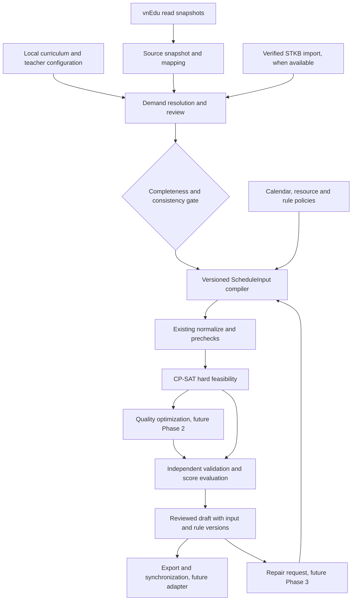

# Kiến trúc Scheduling Core đề xuất

**INFERRED — toàn bộ lựa chọn kiến trúc dưới đây là đề xuất**, chưa triển khai, chưa được coi là quyết định nghiệp vụ của trường. Căn cứ: [truy vết demand](01-demand-provenance.md), [coverage](02-business-coverage.md), [35 gap Phase 1](03-phase1-gap-analysis.md) và [so sánh trước](../stkb-fet-vnedu-comparison.md). Không thay Core hiện tại, không thêm Electron/HTTP/DB.

## 1. Chọn hướng nào?

| Hướng | Điểm mạnh | Chi phí/giới hạn | Đề xuất |
|---|---|---|---|
| Dùng/port engine FET | Source activity/constraints/recursive repair đã có, hệ sinh thái mẫu phong phú | Khác schema/workflow vnEdu; AGPL cần đánh giá trước tích hợp/phân phối; port không đem theo chứng minh correctness/hiệu năng | Giữ làm đối chiếu/mẫu kiểm thử, chưa chọn làm engine sản phẩm |
| CP-SAT độc lập | Kế thừa Phase1, semantics và version contracts rõ, kiểm thử mô hình/evaluator độc lập | Rules mềm/repair/multiweek vẫn phải thiết kế và benchmark | Chọn làm nền chính |
| CP-SAT + repair heuristic | Khoanh vùng sửa/hints, giữ lịch cũ, có thể cải thiện trải nghiệm | Cần global validation, boundary rules và budget; chưa có bằng chứng nhanh hơn | Thêm sau baseline correctness/quality, không viết hai solver cùng lúc |

Không mô phỏng mọi thủ thuật STKB/FET trong CP-SAT. Tách kỹ thuật có ích khỏi triển khai và thang điểm cụ thể.

## 2. Các ranh giới dữ liệu

Trong Phase1, nhánh quality chưa có. Storage, IPC/job worker và vnEdu adapter ở ngoài `tkb_core`; source snapshot không được lọt credential vào domain/fixtures/log. API lấy dữ liệu và thao tác publish là hai luồng độc lập.

| Thành phần logic | Nhận/trả dữ liệu và invariant | Trạng thái |
|---|---|---|
| Source snapshot + mapping | IDs có namespace, năm/kỳ/scope, raw values và hash; phát hiện missing GV, không tự hợp nhất điểm trường hoặc tạo GV giả | Đề xuất application |
| Curriculum/demand worksheet | Defaults theo năm/chương trình/khối/môn/buổi, override theo lớp/phân công, đơn vị/cycle và provenance; zero tách unknown | Đề xuất application |
| Calendar/policy resolver | Ngày thật/buổi/break, availability, room/site, precedence trường→nhóm→cá nhân được chọn rõ | Đề xuất application, một phần biểu diễn Core đã có |
| Input compiler | Chỉ xuất confirmed requirements; conservation tổng→block durations; identity mapping/lock review, version và hash | Đề xuất ngoài I/O Core |
| Normalize/domain/precheck | Guard kích thước, miền placement hợp lệ, tải/khóa/phòng; không gọi mạng, không đoán định mức | Đã có Phase1 |
| Hard model | Đủ demand, occupancy, availability, duration và lock; custom rules chỉ bật khi có implementation | Đã có cơ bản Phase1 |
| Quality model/evaluator | Penalty có unit, scope, priority, bounds và breakdown độc lập | Phase2 đề xuất |
| Repair | Incumbent có input identity, hard locks, vùng sửa và mục tiêu ít thay đổi | Phase3 đề xuất |
| Validation/reporting | Độc lập cách dựng miền/model; full demand, hard constraints, resource footprints; future score recomputation | Validator cơ bản đã có |
| Run lifecycle | Budget/seed/workers, job IDs, cancellation, validated incumbent, persistence/version/sync | SolveOptions cơ bản có; worker/application chưa có |

Đây là trách nhiệm logic, không yêu cầu tạo10package/service. Giữ cấu trúc repo; thêm ít module nhất khi có use case và phase được duyệt.

## 3. Correctness trước chất lượng

**Đề xuất invariant bắt buộc:**

1. Đủ danh mục và định mức đã xác nhận không đồng nghĩa model khả thi. Tách input-invalid, unresolved business data, unsupported capability, precheck infeasibility và solver status.
2. Không biến thiếu tiết/vi phạm occupancy/khóa thành soft để có lịch đẹp. Chỉ dùng hard relaxation trong chế độ chẩn đoán riêng, phải trả danh sách vi phạm và cấm publish như full schedule.
3. Mọi occurrence chiếm toàn footprint, toàn teachers/atomic learners/room. Khi mở multi-participant, sửa cả prepare, capacity, model và independent validator; không chỉ bỏ guard.
4. Calendar có real day, session và footprint phút rõ. Block2 khác hai occurrences cần consecutive; consecutive qua break phải có policy riêng. Week parity không suy từ tên ngày/số tiết trung bình.
5. Sửa split thay đổi ordinal-duration mapping; lock từ snapshot cũ phải remap hoặc báo stale. Phase1 IDs ổn định với cùng decomposition, không hứa ổn định qua mọi sửa demand.
6. Phân biệt hard validity, demand completion và objective quality. Chỉ accept/so sánh lịch sau independent validation toàn lịch, kể cả khi chỉ repair một vùng.

CP-SAT có các trạng thái riêng như FEASIBLE/OPTIMAL/INFEASIBLE/UNKNOWN; timeout không phải chứng minh vô nghiệm. Model feasibility không objective không biến OPTIMAL thành “lịch đẹp nhất”. Đây cũng là phân biệt nêu trong [hướng dẫn CP-SAT chính thức](https://developers.google.com/optimization/cp/cp_solver), đối chiếu với `solver/cp_sat.py::map_status` hiện có.

## 4. Rule semantics và CP-SAT

Các hàng sau là **đề xuất mô hình**, không tuyên bố đã được triển khai:

| Nhóm quy tắc | Semantics cần chốt | Hướng mô hình và evaluator |
|---|---|---|
| Không trùng/availability | Resource vật lý và thời gian, unknown khác unavailable | Kế thừa indexed occupancy; mở participant expansion khi cần |
| Định mức theo buổi | TổngN, quota buổi cố định hay chỉ preference | Compile requirements riêng khi đúng semantics; nếu chung demand và quota kết hợp thì sum placement theo buổi, giữ tổngN |
| Max môn/ngày | Đếm periods hay components; real day hay half-day | Sum duration footprints hoặc count start/group theo lựa chọn, không trộn hai unit |
| Cách môn/min-days | Quan hệ giữa components cùng requirement/group, khoảng ngày, exception consecutive | Forbid cặp placements vi phạm khi hard; violation Boolean/cost khi soft; evaluator đếm cùng unit |
| Cặp/đôi | Block bắt buộc hay số cặp mong muốn; có giữ pair khi repair không | Fixed duration2 hiện có; pairing/alternative patterns chỉ mở khi semantics/identity rõ |
| Tải GV | Max periods/buổi/ngày, số ngày/buổi dạy; không dùng tải quy đổi thay occupancy | Linear sums và day/session-used Boolean, ưu tiên bounds nhỏ |
| Gaps | Gap nội bộ giữa tiết đầu/cuối; excluded break/SH/nonteaching có tính không | Used/first/last hoặc prefix/suffix trên calendar đã chốt; validator tự tính từng resource/day/session |
| Phòng | Required vs optional, eligibility/capacity, preferred room là soft | Giữ placement room; future penalty đổi phòng/room preference; không hậu xử lý để bỏ qua thiếu phòng |
| Điểm trường | Slot overlap và travel time giữa địa điểm | Cấm cặp placements không đủ khoảng di chuyển hoặc dùng circuit/sequence chỉ nếu cần và đã đo |
| Tuần A/B | Repeat horizon, parity, nghỉ lễ/tuần ngoại lệ, quota nguyên theo tuần | Version calendar/cycle rõ; expand week instances trước; không đặt duration0.5 |
| Sự kiện chung | Resources thật sự tham gia, giáo viên bắt buộc hay tùy chọn | Dựng typed event hoặc requirements đã xác minh; không dùng sentinel GV; cần contract extension nếu model hiện tại không biểu đạt |
| Lớp ghép/tách | Danh tính học sinh/subgroup có chồng lấn | Atomic membership hoặc conflict graph có bằng chứng; hai class IDs khác nhau chưa đủ chứng minh không xung đột |

Mỗi rule record tương lai cần `rule_id`, version, scope/participants, parameters/unit, hard/soft, nguồn policy và severity. Cho kế thừa cấu hình nhưng resolver phải xuất rule hiệu lực rõ ràng, có giải thích; không chép precedence mâu thuẫn trong help STKB.

## 5. Chất lượng và tìm kiếm

**INFERRED:** dùng nhiều mức ưu tiên thay vì một tổng weight tùy ý: (a) feasibility/hard, (b) ít thay đổi đối với repair, (c) yêu cầu sư phạm/giáo vụ đã chốt, (d) comfort như gaps. Thứ tự (b)/(c) còn cần trường quyết định. Có thể solve tuần tự từng tầng, giữ bound tối ưu đã chứng minh; nếu timeout ở tầng trước, báo tầng/giá trị chưa tối ưu và không giả đó là lexicographic optimum. Nếu dùng weighted sum phải chứng minh bounds và tránh overflow.

Học FET cách thu hẹp miền, khó trước, rollback/incumbent, ghi seed; học STKB preview/delta và các lệnh tinh chỉnh có phạm vi. Giữ CP-SAT search mặc định ban đầu. Hints là gợi ý, không phải lock; dữ liệu cũ không hợp lệ chỉ là nguồn gợi ý sau đối soát. APIs hint/assumptions/stop-search được tài liệu [cp_model chính thức](https://or-tools.github.io/docs/pdoc/ortools/sat/python/cp_model.html) cung cấp; dùng được với từng model/solver setting vẫn phải test trên version pin của repo. Không dựa vào assumption core như lời hứa minimal unsat explanation.

## 6. Repair, lifecycle và hiệu năng máy người dùng

**INFERRED:** repair nhỏ bắt đầu bằng khóa ngoài vùng, tối thiểu hóa thay đổi trong vùng. Vùng chứa teachers/classes/rooms liên quan và mọi rule xuyên biên, mở rộng theo budget nếu chưa có nghiệm. Infeasible dưới locks không chứng minh bài toán toàn trường vô nghiệm. So sánh change cost theo occurrence đã remap, tách đổi giờ/phòng/GV nếu được phép; giữ nguyên hard lock.

Worker tương lai giữ input fingerprint, run ID và best validated incumbent. Cancel/timeout trả kết quả hợp lệ nếu thực có; kill process có thể mất incumbent chưa ghi. Chỉ ghi draft mới, không thay published schedule hoặc sync từ stale job. Mọi version lịch đi cùng input/config/rule version, khắc phục giới hạn phương án STKB chỉ lưu lịch.

Hiệu năng: đo số occurrences/domains/Boolean/occupancy terms, thời gian prepare/model/first-feasible/best/validation, RAM peak và objective breakdown. Giữ sparse placements Phase1, symmetry breaking chỉ cho occurrences thật sự hoán vị được (không phá lock/preference); không chia độc lập theo điểm trường nếu chung GV hoặc rule liên vùng. So fixed patterns trước, alternative split/hybrid sau benchmark. Không đặt SLA hay khẳng định FET/STKB/CP-SAT nhanh hơn khi chưa có bộ đo tương đương.

## 7. Ranh giới giấy phép và phạm vi

FET AGPL được xác minh trong source overview; cần đánh giá điều kiện khi định tích hợp/link/phân phối. Báo cáo này dùng ý tưởng và bằng chứng để thiết kế độc lập, không sao chép implementation vào sản phẩm. Không đưa định mức tham khảo trong help thành quy định giáo dục hiện hành; trường cần xác nhận bộ cấu hình áp dụng. Không đụng cơ chế kích hoạt/bản quyền.
