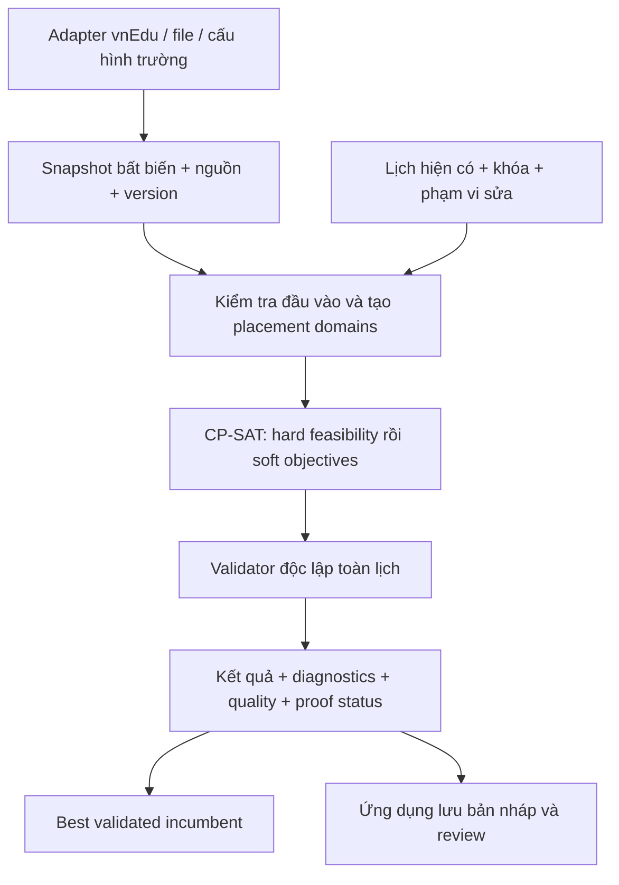

# Scheduling Core vnEdu — thiết kế kết hợp STKB, FET và CP-SAT

Trạng thái: **đề xuất thiết kế để review**, ngày 2026-10-25; chưa triển khai hoặc benchmark core mới. Người dùng yêu cầu chọn các kỹ thuật bổ sung tốt nhất cho nhau rồi thiết kế lại. Kiến trúc Electron + React/TypeScript, Python + OR-Tools CP-SAT local và SQLite đã được người dùng chọn; tài liệu này tập trung engine, không thiết kế giao diện.

**VERIFIED**: bằng chứng source/binary/thử nghiệm hoặc quyết định người dùng. **INFERRED**: lựa chọn thiết kế mới. **UNKNOWN**: dữ liệu hay policy chưa xác nhận. Trừ bảng bằng chứng, mọi hành vi core dưới đây là **INFERRED — thiết kế đề xuất**, không phải phần mềm đã tồn tại.

## 1. Mục tiêu và tiêu chí thành công

Core nhận snapshot đã chuẩn hóa và trả lịch đủ tiết, đúng phân công, không vi phạm hard, có giải thích lỗi và breakdown chất lượng. Có hai use case: xếp mới và sửa phần được phép của một lịch hiện có. Hai use case dùng chung domain, rule semantics, model và validator.

Một lịch có chất lượng tốt nhưng thiếu tiết, đổi GV phân công hoặc phá khóa không phải kết quả hợp lệ. Mục tiêu mềm không được mua quyền vi phạm hard. Không hứa tìm được nghiệm hoặc chứng minh vô nghiệm trong mọi budget.

Không đưa vào phạm vi này: UI, schema SQLite chi tiết, vnEdu sync, viết lại FET/STKB, tương thích file STKB hoàn toàn, kích hoạt/bản quyền và solver tự đổi GV để dễ xếp. Không cần tái tạo toàn bộ 357 lớp FET hoặc khôi phục hết mã YC của STKB.

## 2. Approaches — phương án và lựa chọn

| Phương án | Ưu điểm | Đánh đổi | Quyết định |
|---|---|---|---|
| Tái triển khai thuật toán recursive swapping/FPR/DPR | Gần các chiến lược đã nghiên cứu | Hai nguồn có semantics khác; STKB chưa khôi phục đủ; phải tự xây nhiều nhánh tìm kiếm/checker | Không chọn |
| CP-SAT làm bộ giải duy nhất, domain/rule/validator riêng | Phù hợp kiến trúc đã chốt; một bộ hard semantics cho xếp mới và sửa lịch | Cần đo encoding/domain và đặc tả từng rule đúng | **Chọn cho core ban đầu** |
| CP-SAT cộng greedy/tabu/local search riêng ngay từ đầu | Có thể thử nhiều cách khởi tạo/sửa | Chưa có benchmark chứng minh lợi ích, tăng số đường có thể tạo lịch sai | Để sau khi có vấn đề đo được |

Người dùng đã chọn CP-SAT trong kiến trúc và giao lựa chọn kỹ thuật kết hợp; lựa chọn cách tổ chức core ở hàng thứ hai là đề xuất của người thiết kế. Không tuyên bố FET hoặc STKB dùng CP-SAT. Repair ban đầu là giải lại model có vùng đóng băng, chưa phải một thuật toán tìm kiếm bên ngoài CP-SAT.

## 3. Chọn những gì từ mỗi nguồn

| Kỹ thuật có bằng chứng | Nguồn | Cách dùng trong thiết kế mới | Điều không suy ra |
|---|---|---|---|
| Phân công, lịch lớp/GV/phòng, kiểm tra xung đột theo resource | STKB [S1–S3] | Assignment là nguồn duy nhất; ba view là dữ liệu suy ra | Không giữ ba bản lịch độc lập rồi đồng bộ thủ công |
| Tiết đôi, cách môn, tải dạy, tiết trống và nghỉ buổi | STKB [S5–S6] | Giữ thuật ngữ nghiệp vụ và chuyển thành rule có đơn vị/ví dụ rõ | Không sao chép trọng số/mã chưa giải nghĩa |
| Thử chuyển/hoán đổi và chỉ commit sửa thành công | STKB [S4] | Repair dùng bản làm việc, validate toàn lịch rồi mới nhận incumbent | Không khẳng định FPR/DPR đã có objective minimal-change |
| Activities có duration, nhiều GV và nhóm học sinh thành phần | FET [F1–F2] | Domain occurrence/block với tập participants và footprint | Không coi một activity luôn là một tiết đơn/một lớp/một GV |
| Availability, duration, fixed time/room, domain preprocessing | FET [F3–F4] | Loại placement hard-invalid trước khi tạo model | Không loại preference như hard |
| Quan hệ giữa hoạt động, ngày thật/buổi và penalty theo từng loại | FET [F5–F8] | Rule catalog tường minh; chỉ bật rule phù hợp trường | Không dùng phần trăm FET làm trọng số CP-SAT |
| Conflict ordering, recursive reinsertion | FET [F9] và STKB [S4] | Conflict graph chọn vùng repair; heuristic hint chỉ sau benchmark | Không viết lại cây ejection/tabu ngay |
| Fitness/conflict reports, current/highest và cancel | FET [F10–F11] | Validator độc lập, incumbent hợp lệ, status/budget rõ ràng | Số đã đặt không thay thế chất lượng và tính hợp lệ |

Các nhãn [S1–S7], [F1–F11] trỏ tới [sổ bằng chứng trong đối chiếu](../../research/stkb-fet-vnedu-comparison.md#8-sổ-bằng-chứng-đối-chiếu), nơi ghi hàm/VA STKB và file/dòng source FET. Đây là tham chiếu bằng chứng, không phải mã nguồn được đưa vào sản phẩm.

## 4. Kiến trúc tối thiểu



Core Python chỉ cần các phần: `domain`, `preprocess`, `cp_sat`, `validate`, `repair`, `worker`. Chưa tạo package/file triển khai; tên này là ranh giới trách nhiệm. `repair` gọi lại preprocess/model/validate, không có checker riêng. Không tạo framework plugin hoặc nhiều solver backend khi chưa cần.

Adapter/host đọc API, file và SQLite. Worker không có credential vnEdu, không gọi API, không ghi dữ liệu server. Contract trao đổi ban đầu là JSON qua stdin/stdout từng dòng giữa host và Python; stdout chỉ là event/result, stderr là log đã lọc. Payload lớn có thể chuyển sang snapshot file local do host quản lý khi đo thấy cần, không thêm transport khác ngay.

## 5. Domain và dữ liệu đầu vào

Chi tiết field/nguồn/validation kế thừa [dự thảo đầu vào và C01–C22](../../research/scheduling-core-input-and-rules-draft.md). Thiết kế bổ sung các quyết định sau:

- **Identity:** giữ ID nguồn dưới namespace, tạo index đặc riêng trong job. ID lớp/GV không phụ thuộc tên, buổi hoặc điểm trường. Không đồng nhất `gv_id` và `giao_vien_id` chỉ vì hiện có cùng giá trị.
- **Horizon:** tuần điển hình là profile ban đầu đề xuất, phải được xác nhận từ nguồn demand. Calendar mô tả ngày thật, buổi, slot và khoảng phút `[start,end)` từ đầu horizon; biên tiếp xúc không phải overlap. Ngày nghỉ và break là dữ liệu, không phải kích thước hardcode 7×5.
- **Demand:** một nghĩa vụ dạy có môn, participants, tổng tiết và nguồn/đơn vị xác nhận. Mã chủ nhiệm `-2` giữ riêng, chỉ chuyển thành hoạt động khi có policy số tiết/giờ thật. Không phát sinh demand từ tên môn hoặc chương trình giả định.
- **Block:** chia demand thành occurrences có ID ổn định và duration tính tiết; tổng duration phải bảo toàn. Chia block được khai báo trước solve bản đầu, chưa để solver tự chọn mọi cách chia.
- **Participants:** tập GV và tập atomic learner groups. Lớp thường ánh xạ một nhóm; lớp ghép là một hoạt động với nhiều nhóm, tách lớp cần các nhóm thành phần thật, đồng giảng là nhiều GV trong một hoạt động. Các hoạt động đó không được biểu diễn bằng hai bản sao để né kiểm tra.
- **Placement:** occurrence, ngày/buổi, chuỗi slot, các khoảng phút chiếm tài nguyên, phòng/cơ sở khi áp dụng. Duration tính tiết khác số phút; hai cơ sở có giờ tiết khác vẫn so overlap bằng phút thật.
- **Phòng:** mode không xếp phòng chỉ chứng nhận lịch thời gian, ghi `room_scope=excluded`. Nếu có hoạt động bắt buộc cần phòng, thiếu room data không được âm thầm chuyển sang mode này. Khóa phòng không tự khóa thời gian và ngược lại.
- **Incumbent:** gắn snapshot/demand version và occurrence IDs; thay phân công hoặc cách chia block cần reconciliation trước repair. Không dùng vị trí ô hoặc thứ tự API làm identity.

Đối với block, profile đầu không cho vượt buổi/ngày/break. Khi chưa có đặc tả xử lý khoảng nghỉ trong block, chỉ tạo placement có chuỗi tiết liên tiếp không có break. Nếu trường cần hai hoạt động nối tiếp qua giờ nghỉ, đó là quan hệ giữa hai hoạt động, không tự coi là một block.

## 6. Hợp đồng ràng buộc

Mỗi rule có `rule_id`, `type`, `scope`, tham số, `severity`, đơn vị penalty, tier/weight nếu soft, nguồn và version. Hard không có weight để đánh đổi. Một rule bật phải có compiler, evaluator độc lập và bộ ví dụ đạt/không đạt; chưa hỗ trợ thì trả lỗi capability, không bỏ qua.

| Tầng | Ràng buộc | Cách xử lý |
|---|---|---|
| Hợp lệ nền tảng | C01–C03, C05–C08, C21 | Đủ demand, không trùng GV/người học, calendar/availability, giữ khóa, duration và hoạt động chung |
| Hợp lệ có điều kiện | C04/C09; C20 khi có yêu cầu di chuyển vật lý | Chỉ chứng nhận khi có room/travel data cần thiết; thiếu dữ liệu là lỗi hoặc scope bị giới hạn rõ |
| Policy trường | C10–C15, C17–C19 | Trường xác nhận hard/soft, giới hạn, ngoại lệ và đơn vị trước khi bật |
| Tiết trống và chất lượng | C16 cùng các policy đã chọn | Trần gap có thể hard theo trường; mục tiêu giảm gap là soft riêng. Không gộp hai ngữ nghĩa |
| Sửa lịch | C22 | Khóa là hard; giảm thay đổi là objective theo profile repair |

Travel là ràng buộc vật lý khi trường yêu cầu: hai hoạt động của cùng GV ở hai cơ sở chỉ được nối nếu khoảng giữa đủ travel time. Dùng dữ liệu hướng đi nếu khác nhau. Không xem chống trùng giờ đã đủ chống thiếu thời gian di chuyển. Nếu thiếu travel data, không gắn nhãn lịch đã kiểm chứng khả thi về di chuyển.

Ngữ nghĩa travel áp giữa **hai hoạt động kế tiếp theo thời gian của cùng GV trong ngày**, kể cả có break ở giữa; thời gian sẵn có là khoảng từ end đến start thực. Không mặc định input travel matrix có bất đẳng thức tam giác và không tự sửa matrix thành shortest paths. Khi biên dịch model phải biểu diễn quan hệ kế tiếp; chỉ dùng cấm mọi cặp thiếu thời gian khi đã kiểm chứng và ghi lại điều kiện tương đương của matrix. Nếu compiler chưa hỗ trợ semantics của matrix được cung cấp, báo capability error thay vì siết sai bài toán.

Bản đầu không tự đặt mọi rule FET/STKB thành hard. Cũng không làm mềm cấm bận/khóa để lấy một lịch “đẹp”. Từng policy chất lượng chọn rõ cách đếm: gap nội bộ khác rảnh đầu/cuối; min-load chỉ áp vào ngày/buổi có hoạt động; tải ngày cộng cả hai buổi; cặp đôi không đếm chồng trong chuỗi dài.

C15 bản đầu hỗ trợ cấu trúc block bắt buộc được khai báo trước. Ưu tiên tiết đôi dạng soft nhưng cho phép solver đổi cách chia demand cần encoding split alternatives riêng; chưa thuộc compiler ban đầu và phải trả unsupported nếu được bật. Không tuyên bố một split cố định đã tối ưu được số block đôi mềm.

## 7. Tiền xử lý và model CP-SAT

### 7.1. Preflight và domains

1. Validate identity, nguồn/đơn vị demand, scope/calendar, participants, split và khóa; dựng resource index.
2. Tạo starts hợp lệ theo duration/calendar. Áp cấm hard và fixed-time; chọn phòng phù hợp nếu thuộc scope.
3. Gắn footprint, lọc conflicts với lịch bận/hoạt động cố định ngoài scope. Travel liên quan incumbent ngoài scope phải được kiểm tra.
4. Kiểm domain rỗng, khóa mâu thuẫn, demand vượt sức chứa và các điều kiện cần khác; báo rule/resource/source liên quan.
5. Đo số occurrences, placements, resource edges và ước lượng kích thước model. Nếu vượt giới hạn vận hành, trả `RESOURCE_LIMIT` có số đo; không cắt miền âm thầm hoặc tự bỏ hard.

Preflight thành công không chứng minh có nghiệm. `INVALID_INPUT` khác miền thật sự vô nghiệm; chẩn đoán phải nêu nguyên nhân bằng dữ liệu có thể đối chiếu.

### 7.2. Encoding ban đầu

Chọn Boolean placement encoding cho bản đầu để dễ đối chiếu validator. Với mỗi occurrence `a`, `P[a]` là toàn bộ placement được cho phép; biến `x[a,p]` chọn placement.

```text
Mỗi occurrence: sum(x[a,p] cho p trong P[a]) = 1
Mỗi resource và đoạn thời gian thực: sum(x[a,p] chiếm đoạn đó) <= 1
Khóa và đóng băng: giữ đúng các thành phần placement được chỉ định
Policy hard: thêm công thức theo rule đã được xác nhận
```

Chống overlap bằng các đoạn thời gian nguyên tử tạo từ mọi biên phút của candidate footprints và lịch ngoài scope, không chỉ nhóm các slot có cùng tên. Co-teaching chiếm mọi GV; hoạt động ghép chiếm mọi nhóm người học nhưng chỉ chiếm phòng một lần. Hard travel theo quan hệ kế tiếp ở mục 6: nếu hai activity được chọn là kế tiếp thì `start_next - end_prev >= travel(site_prev, site_next)`. Không cấm mọi cặp một cách vô điều kiện. Đo chi phí biến/quan hệ thứ tự trong budget model; không âm thầm bỏ travel để giảm kích thước.

Block-count feasibility được kiểm qua normalization và ExactlyOne. Quy tắc tải/cách môn dựa trên tổng duration và ngày/buổi thật. Không thêm Boolean “bỏ tiết” trong model dùng để tạo lịch chính thức.

Với phòng có nhiều lựa chọn, placement ban đầu gồm cả room để giữ một nguồn semantics. Đo độ phình miền; nếu cần, chuyển sang biến thời gian/phòng tách hoặc optional intervals trong một bước thay encoding có regression tests. Không duy trì đồng thời hai encoding trước khi có lý do đo được.

Khó xếp, ít domain và conflict degree dùng cho diagnostics trước. Hint/đổi search order là tối ưu sau benchmark; seed không bảo đảm lịch giống nhau qua mọi phiên bản/worker count.

**VERIFIED — khả năng thư viện, không phải core đã viết:** CP-SAT có Boolean/integer constraints, hints, intervals và solver status; xem [Python API](https://or-tools.github.io/docs/pdoc/ortools/sat/python/cp_model.html). Version OR-Tools cụ thể phải pin và kiểm tra khi triển khai; không giả định workspace đã cài.

## 8. Chất lượng lịch và budget

Pha đầu tìm nghiệm đủ hard. Các pha tiếp theo tối ưu mục tiêu nguyên theo thứ tự tier. Không có hệ số mặc định suy ra từ 30 score STKB hoặc percentage FET.

| Profile | Thứ tự đề xuất để trường review |
|---|---|
| Xếp mới | Hard feasibility → tính gọn/phân bố lịch học sinh → tải/ngày đi dạy/gaps GV → preference giờ/phòng |
| Sửa theo yêu cầu mới | Hard, khóa và thay đổi bắt buộc → số activity đổi giờ → số activity đổi phòng → chất lượng theo profile xếp mới |
| Tinh chỉnh chất lượng | Hard và khóa, giới hạn số thay đổi được phép → chất lượng theo profile đã chọn → ít thay đổi khi quality bằng nhau |

Đây là thứ tự đề xuất, chưa phải ưu tiên trường đã xác nhận. Mỗi tier gồm các metric có weight nguyên, đơn vị, bound và ví dụ; không đưa hai metric khác nghĩa vào cùng tier bằng weight tùy tiện. Không dùng một học kỳ/ngày có tên giống nhau để tính khoảng cách sai horizon.

Tối ưu lexicographic theo chuỗi solve trong **một tổng budget**. Chỉ cố định optimum tier trước và chuyển tier sau khi solver đã chứng minh optimum tier đó. Nếu chỉ có `FEASIBLE` khi hết budget, trả incumbent cùng tier chưa chứng minh; không tiếp tục dưới nhãn lexicographic tối ưu. Có thể resume trong job mới với nguồn/hint rõ ràng.

Các trường kết quả: từng metric raw value/unit, weight/tier, objective/bound của pha thực sự chạy và proof status. Không lấy tổng conflict của FET hoặc score STKB làm số so trực tiếp. Chưa hứa hiệu năng hay “đẹp hơn” trước benchmark cùng dữ liệu/semantics.

**VERIFIED — thư viện:** CP-SAT có trạng thái OPTIMAL/FEASIBLE/INFEASIBLE/MODEL_INVALID/UNKNOWN; status chỉ chứng nhận model được encode. [Solver status](https://developers.google.com/optimization/cp/cp_solver), [time limit](https://developers.google.com/optimization/cp/cp_tasks).

## 9. Sửa lịch theo vùng, lấy tinh thần FPR/DPR và reinsertion

1. Nhận incumbent cùng demand version, tập activity được phép sửa, khóa và **mục đích**: sửa theo yêu cầu mới hay tinh chỉnh chất lượng. Yêu cầu mới phải khai báo cụ thể, ví dụ chuyển một tiết tới vị trí chỉ định hoặc thêm lịch bận; một tập được phép sửa tự nó không ép lịch thay đổi.
2. Dựng vùng từ activity được chọn; mọi activity ngoài vùng đóng băng ở vị trí incumbent. Dùng full hard model, nên tải ngày/cách môn/travel ở biên vẫn có hiệu lực.
3. Với sửa theo yêu cầu mới, áp các thay đổi bắt buộc rồi tối ưu số activity đổi giờ trước chất lượng. Với tinh chỉnh, yêu cầu ngân sách thay đổi `K` do job cung cấp, giữ `changed_count <= K` rồi tối ưu chất lượng trước; nếu tối thiểu thay đổi trước sẽ thường giữ nguyên incumbent hợp lệ. Khóa cứng luôn giữ nguyên, kể cả trong vùng sửa. `K` đếm occurrence đổi time hoặc room, mỗi occurrence tối đa một lần; metrics time/room vẫn tách riêng cho tie-break.
4. Nếu vùng hiện tại đã được chứng minh vô nghiệm, mở dần qua resource conflict graph trong phạm vi người dùng cho phép. Với timeout/UNKNOWN, không gọi vùng là vô nghiệm; retry/mở vùng phải tuân budget và có event giải thích.
5. Khi không còn vùng được phép mở hoặc hết budget, trả kết quả và giới hạn đã biết. Không phá khóa hoặc tự sửa ngoài scope.
6. Validate toàn lịch; chỉ thay incumbent khi đủ hard và cải thiện theo profile. Nếu repair chất lượng dùng incumbent đã hợp lệ, giữ nguyên incumbent là phương án dự phòng hợp lệ.

Nếu incumbent đang vi phạm hard, chỉ được dùng như nguồn lịch tham chiếu/hint sau kiểm tra mapping, không lưu nhãn “best validated”. Phải chọn vùng đủ chứa mọi hoạt động có thể gây conflict hoặc báo vùng đóng băng còn mâu thuẫn.

Occurrence IDs ổn định giữa các phiên bản tránh đếm thay đổi giả do hoán vị các tiết tương đương. Nếu import không có occurrence identity, reconciliation ghép các block tương đương với lịch cũ trước solve, ghi provenance và ambiguity; không tự bật repair khi mapping chưa xác nhận. Không áp symmetry breaking làm đổi thứ tự occurrence đã có khóa/incumbent.

Không triển khai tabu/ejection tree riêng. Nếu benchmark repair cần thêm neighborhood strategy, bổ sung quanh cùng hard model và validator; không tạo một nhánh sửa ô bỏ qua rule toàn lịch.

## 10. Validator và báo lỗi

Validator nhận snapshot + assignments, tự kiểm identity, duration/footprint, demand, resource overlap, room eligibility, availability, locks, travel và mọi hard rule bật. Tự tính soft metrics từ assignments; không dùng biến helper CP-SAT để “chứng minh” model đúng. Rule parameters dùng chung nhưng compiler và evaluator là hai cách tính độc lập.

Mỗi violation có `rule_id`, severity, activity/resource IDs, thời gian, actual/limit, source reference và message code. Không log mật khẩu, token hoặc đầy đủ hồ sơ cá nhân. Report nhóm theo GV/lớp/phòng chỉ là view suy ra từ cùng assignments.

Preflight cung cấp lỗi cụ thể khi có thể: thiếu ID, thiếu demand, không có placement, khóa trùng hoặc tải quá sức chứa. Giải thích vô nghiệm bằng assumptions là khả năng có thể nghiên cứu sau; chưa hứa có tập nguyên nhân tối thiểu cho mọi model. Không viện dẫn tên hàm STKB để giải thích một constraint chưa được xác minh.

## 11. Worker, trạng thái và incumbent

Một solve job chạy trong process Python riêng; snapshot bất biến. Host gửi `solve` hoặc `cancel` có `job_id`; worker phát `started`, `phase`, `progress`, `candidate`, `finished`/`failed`. Event/result có `schema_version`, `job_id`, `input_hash`, model/rule/solver versions. `candidate` chỉ có nhãn valid sau khi validator kiểm tra; progress không hứa phần trăm hay ETA tuyến tính.

Run config bắt buộc tổng budget và worker count; không đặt mặc định hiệu năng từ benchmark FET. Seed dùng cho thử nghiệm có ghi lại. Budget theo monotonic clock gồm preprocessing/build/solve; dành thời gian validate, serialize và cleanup, host có watchdog. Hủy có thể xảy ra trước callback, nên control reader phải gọi stop từ ngoài callback; không dựa callback incumbent mới để nhận cancel.

Tách các trường:

- `termination_reason`: completed / time_limit / cancelled / resource_limit / failed.
- `solver_status`: not_run hoặc trạng thái CP-SAT thực sự, theo pha đã chạy.
- `validation_status`: not_checked / invalid / valid_complete, kèm coverage time/rooms/travel và hard-rule set đã kiểm.
- `incumbent`: lịch tốt nhất đã validate trong job, nếu có; không nhầm với lịch publish hoặc partial debug.
- `quality`: metric values, objective/bound và proof từng pha; dữ liệu thời gian/memory/model size.

Input lỗi được phân loại riêng trong `diagnostics` khi chưa chạy solver. Solver báo feasible nhưng validator sai là lỗi triển khai, không trả như lịch dùng được. Model invalid là lỗi model/config, không phải vô nghiệm trường. Timeout/cancel có thể đi cùng incumbent hợp lệ nhưng chưa tối ưu. Crash/watchdog không tự suy ra nghiệm đã hoàn tất; host chỉ giữ các candidate đã nhận và xác minh đúng job/input hash.

Host lưu bản nháp/version theo transaction; không đồng bộ vnEdu trong worker. Kết quả job cũ không thay snapshot mới nếu hash/revision không khớp. Lượt thiết kế này không tạo IPC, SQLite tables hoặc route API ghi.

## 12. Kiểm thử và benchmark trước chấp nhận

1. Các ca nghiệp vụ ở [dự thảo](../../research/scheduling-core-input-and-rules-draft.md#7-bộ-ca-chấp-nhận-tối-thiểu-trước-dùng-dữ-liệu-thật): demand 5 có block đôi, overlap qua cơ sở lệch giờ, khóa từng thành phần, hoạt động chung, thiếu phòng, timeout và repair boundary.
2. Mỗi rule có ví dụ tính tay hard/soft; bài nhỏ đối chiếu bằng vét cạn độc lập. Xáo ID/thứ tự dữ liệu không làm đổi tính hợp lệ hoặc metric. Mỗi rule bật phải có cả model và evaluator coverage.
3. Model cố ý bị lỗi hoặc assignment bị sửa phải bị validator phát hiện; không chỉ test model trả nghiệm và tự đọc lại helper của chính nó.
4. Repair đo số activity đổi, giữ khóa/ngoài vùng, trường hợp không thể sửa trong vùng nhưng có thể sửa khi mở vùng, và timeout khi chưa chứng minh. Có ca tinh chỉnh trong ngân sách K cải thiện quality dù lịch cũ đã hợp lệ; ca travel matrix có hướng/không thỏa tam giác kiểm semantics kế tiếp; ca C16 hard bound tách với soft gap objective.
5. Benchmark thực tế nhiều seed, cùng máy/budget/workers; ghi normalize/preprocess/build/first-feasible/total time, peak RSS, model size, success rate và metric cùng đơn vị.
6. Nếu so FET, chỉ dùng tập rule/semantics tương đương và cùng evaluator ngoài; công bố rule bị loại. Không so lịch đã khóa gần hết với bài xếp từ đầu hoặc dựa score hai engine khác nghĩa.

Chỉ tiêu bắt buộc: 0 hard violations trên mọi lịch được nhận, bảo toàn demand/participants/khóa, status đúng và không mất lịch trước khi lỗi. Mốc thời gian/quality trường chấp nhận còn UNKNOWN, sẽ chốt bằng dữ liệu thật; không tự đặt cam kết tốc độ.

## 13. Thứ tự thực hiện sau review thiết kế

| Mốc | Phạm vi | Điều kiện qua mốc |
|---|---|---|
| A — domain/validator | Snapshot, normalization, C01–C09/C21 theo scope, fixtures synthetic | Ca đạt/không đạt độc lập; lỗi dữ liệu không lọt thành lịch rỗng |
| B — feasibility | Preprocess và CP-SAT placement model | Có nghiệm đúng/vô nghiệm đã biết trên bài nhỏ; đúng IDs/calendar/locks |
| C — quality | Các policy C10–C19 đã được chọn, tier/proof/budget | Metric khớp evaluator/vét cạn nhỏ; không suy giảm hard |
| D — worker | Progress/cancel/watchdog và kết quả có version | Hủy không phụ thuộc callback, stale/crash/timeout không thay lịch trước |
| E — repair | Full model có vùng đóng băng, change objective và mở vùng có giới hạn | Validate toàn lịch, không sửa ngoài phạm vi/khóa |
| F — thực địa | Dataset chuẩn hóa thực và benchmark | Giáo vụ chấp nhận rule/quality; số liệu đủ chọn tối ưu hiệu năng tiếp |

Room/travel hard phải đi cùng mốc feasibility của bất kỳ scope nào yêu cầu chúng; không đẩy sang giai đoạn sau rồi gọi lịch của scope đó là hoàn chỉnh. Fixtures synthetic cho phép kiểm chứng core trước khi adapter STKB đầy đủ, nhưng không thay kiểm chứng dữ liệu thực.

## 14. Khoảng thiếu và lựa chọn được giao cho người triển khai

**VERIFIED — hiện trạng:** API có 527 `so_tiet="0"`, 5 dòng thiếu tham chiếu GV; reader STKB chỉ đọc danh mục. Chưa có calendar/rule profile được trường xác nhận. [API live](../../research/vnedu-api-live-findings.md), [file STKB](../../../reverse-engineering/reports/STKB-file-format-analysis.md).

**UNKNOWN — cần nghiệp vụ hoặc dữ liệu thật:** nguồn/đơn vị số tiết, GV chưa xác định, giờ học/break, availability coverage, phòng/travel bắt buộc, scope lớp/nhóm bản đầu, hard/soft/ngưỡng/tier, lịch tham chiếu đúng phiên bản và budget/quality chấp nhận được. Đây là điều kiện cho các job thực tương ứng; không tự điền chương trình chuẩn, availability rỗng hoặc weights STKB.

**Đề xuất để review:** feasibility trước, một core CP-SAT, Boolean placement ban đầu, tuần điển hình, JSON-line worker, validator độc lập và repair qua full model đóng băng ngoài vùng. Đây là các lựa chọn của người thiết kế, không phải policy giáo vụ đã duyệt.

**Giao người triển khai quyết định trong plan:** cấu trúc file chi tiết, version OR-Tools đã pin, format JSON field chi tiết, giới hạn resource vận hành ban đầu và cách tối ưu bộ dựng overlap sau profiling. Quyết định phải giữ invariant/domain/rule semantics đã nêu; đổi encoding cần regression, không đổi nghĩa hard/soft.

Không thay source FET hoặc sao chép implementation AGPL vào sản phẩm trong thiết kế này. Không tuyên bố thiết kế độc lập tự giải quyết mọi nghĩa vụ giấy phép nếu sau này tái sử dụng mã. Chưa có benchmark chứng minh hybrid này nhanh hơn STKB/FET; “kết hợp” ở đây là chọn kỹ thuật và đặc tả, không ghép mã nguồn hai engine.
